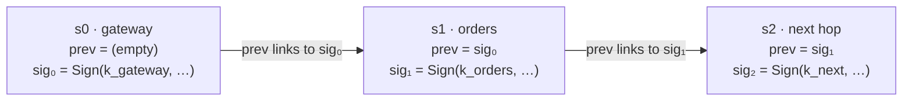
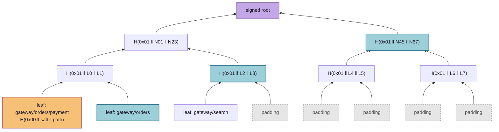

# Paztport

**A passport for requests.** The "zt" stands for zero trust.

Most security asks one question at the door: *who are you?* Paztport asks a
second question that almost nobody asks today: ***how did you get here?***

That second question matters because modern break-ins rarely come through the
front door. An attacker takes over one small, forgettable part of a system, such
as a search box, a reporting tool, or a firewall. From there they don't need to
break anything. They just *ask*. Inside a system, a request from a trusted
component looks exactly like every legitimate request, so the sensitive part (the
payment service, the customer database, the admin panel) does what it's told. In
the 2019 Capital One breach, an attacker tricked a misconfigured firewall into
fetching cloud credentials on their behalf, and the records of more than 100
million people left through a component the system trusted.

## The idea in plain terms

Think about how a passport works. Every border you cross stamps it, and customs at
your destination looks at the stamps, not just at your face. Paztport gives every
request inside a system the same kind of passport:

- **Every step stamps it** with a signature nobody else can forge. Skip a step or
  fake one, and the stamps stop lining up.
- **The destination checks the whole itinerary**, not just the last hop. A payment
  request is accepted only if it arrived by a route on the approved list.
- **The approved list stays sealed.** Each service holds a single fingerprint of
  it, so it can check a route without anyone ever seeing the full map of how the
  system fits together. That includes a partner, and an attacker who gets inside.

When a request turns up with the wrong history, it's refused. That holds even when
its credentials are valid and its contents look perfectly normal. The machine that
sent it can then be moved into isolation and replaced with a clean copy,
automatically, within seconds: in the demo, a responder does exactly that, acting on
the signed events the rejection produces.

## Why it matters

- **It catches the attacks that look normal.** Firewalls, passwords, and
  encrypted connections all wave through a request from a hijacked internal
  service, because it *is* an internal service. Paztport rejects it because of
  where it came from.
- **It shrinks what a break-in is worth.** A compromised component can only do
  what its legitimate position in the system allows. An attacker who takes over
  the search service gets the search service, not the payment system behind it.
- **It keeps your blueprint private.** How your systems connect is exactly the map
  an attacker wants. Paztport checks routes without ever publishing them. The same
  design is meant to let two organisations trust each other's calls without
  swapping architecture diagrams.
- **It makes an automatic response possible and keeps the evidence.** The signed
  events name the offending machine, so a responder can act on them. The demo's
  responder isolates the machine rather than deleting it, so investigators get a
  live specimen while a clean replacement keeps the service running. If the same
  service keeps tripping, it stops and calls a human rather than risk tearing down
  healthy machines after a bad deploy.
- **It fits the AI-agent problem.** An AI assistant that reads a booby-trapped
  email and then sends your files somewhere has the same failure: a trusted
  component doing something because untrusted input asked it to. Requiring proof
  of where an action came from is a natural guardrail for agents too. The
  [agents demo](poc-demos/agents-mcp/README.md) does it for MCP calls, and
  [§6](#6-where-this-could-go) says what is still open.
- **It's cheap.** Checking a request is a few Ed25519 verifications and SHA-256
  hashes; the demos measure what that costs
  ([Java mesh](poc-demos/java-mesh/README.md#measurements),
  [Envoy Gateway](poc-demos/envoy-gateway/README.md#measurements)).
- **It's open.** There's no vendor and no lock-in. It's Apache-2.0 code built
  entirely on standard, well-understood cryptography.

It's also honest about its limits. Paztport doesn't make a compromised machine
trustworthy; it limits how far a compromise can travel. The full list is in
[Known limits](#5-known-limits).

## What's in this repository

A working proof of concept of **path attestation**. A request has to prove the
route it took through a system, and the destination accepts it only if that route
is one the system allows. The allowed routes are committed to a salted Merkle tree,
so a service checks a request against one signed root hash. It never holds, and
never reveals, the full map of valid paths.

It works end to end. In the [Java mesh demo](poc-demos/java-mesh/README.md), a
request with a perfectly valid body, sent by a service that is legitimately on the
network, is **rejected purely because of where it came from**, and the offending
container is **quarantined and replaced automatically**. All the scenarios and a
circuit-breaker check pass (`demo.sh` reports 23 checks), and the overhead has been
measured.

The demo also tells a story across two organisations. A customer's support ticket
passes through a ticket service, which labels the text as third-party, to an
assistant, which is a **scripted stand-in for a hijacked model, with no model in
it**. It reads the customer's private order and tries a refund (at a payment
provider that is a second organisation, reached through a boundary attestation)
and an email. An honest ticket is refunded and emailed. A malicious ticket asks
for Alice's data to go to Mallory, and is refused at the mailer and at the
provider from the influence the requests carry, though every hop was a legitimate
position on an allowed route. See
[the support-assistant storyline](poc-demos/java-mesh/README.md#the-support-assistant-storyline).

The idea is offered freely. The code is Apache-2.0, and every cryptographic
primitive comes from each language's standard library (the JDK, Node's
`node:crypto`, Go's `crypto` packages), so anyone can lift it into their own stack.

---

## Contents

1. [The problem: every hop trusts only its neighbour](#1-the-problem-every-hop-trusts-only-its-neighbour)
2. [Two proofs that bind together](#2-two-proofs-that-bind-together)
3. [Security principles](#3-security-principles)
4. [How it compares](#4-how-it-compares)
5. [Known limits](#5-known-limits)
6. [Where this could go](#6-where-this-could-go)
7. [Running it](#7-running-it)
8. [Repository layout](#8-repository-layout)
9. [Where to go next](#9-where-to-go-next)

---

## 1. The problem: every hop trusts only its neighbour

Distributed systems check trust one hop at a time. Service C verifies that
service B called it, and stops there. Nobody asks who called B.

That gap is the **confused deputy** problem. An attacker who compromises B, or
tricks it, inherits every privilege B has downstream. The malicious request looks
identical to a legitimate one: same headers, same body shape, same authenticated
caller. mTLS and SPIFFE identities make the *last hop* trustworthy and say nothing
about the hops before it.

Inspecting the payload can't catch this, because the payload is the part the
attacker controls. What the attacker rarely controls is the request's **history**.
An illicit route leaves a fingerprint even when the request itself is clean.
Paztport turns that history into a credential, and makes it unforgeable.

## 2. Two proofs that bind together

A request is accepted only if it proves **two** things: that it really travelled
the route it claims (*proof of travel*), and that the route is one the system
allows (*proof of legitimacy*). Either proof alone is breakable. Together they
aren't.

### 2.1 Proof of travel: the stamp chain

Each hop appends a **stamp** to the `X-Path-Chain` header. A stamp is signed by
the hop's own Ed25519 key, and it signs over the previous stamp's signature:



| Field | Meaning |
|---|---|
| `v` | Version, always `3`. |
| `svc` | Service name. The route is rebuilt from these and the `rcv` fields. |
| `inst` | Instance (container hostname), so a response targets one replica, not a whole service. |
| `rid` | Request ID, minted by the origin and carried unchanged. |
| `ts` | When this stamp was signed. The last stamp must be within 5 s of the receiver's clock; the origin within a run window (30 min by default; 30 s for the six services a ticket crosses in the Java mesh). |
| `sess` | The session id, or empty for a chain with no session. |
| `rcv` | The receiver this stamp was signed for: the next stamp's `svc`, or the chain's receiver. Over HTTP it may also name an operation, `service#operation`. |
| `bind` | The binding of what *this hop sent*. Over HTTP, `SHA-256(METHOD \n PATH \n BODY)` (`PATH` with its query). |
| `infl` | The influence commitment, empty for no influence. |
| `prev` | The previous stamp's `sig`; empty at the origin. |
| `sig` | Ed25519 signature over the canonical bytes `3\|svc\|inst\|rid\|ts\|sess\|rcv\|bind\|infl\|prev`. |

Why it's built this way:

- **Chaining through `prev = sig`** makes the chain tamper-evident in the same way a
  hash chain is. Remove, reorder, or insert a stamp and some `prev` stops matching,
  or some signature stops verifying.
- **Ed25519 rather than an HMAC** means verifiers need only *public* keys. No
  shared secret is ever distributed, and a compromised verifier can't forge stamps.
- **The receiver binding**, `rcv`, names the hop each stamp was handed to. A chain
  forwarded unchanged to any other service fails `BINDING_MISMATCH`.
- **The request binding** ties the chain to the actual payload. The receiver
  recomputes `bind` from the request it got and compares it to the **last** stamp.
  A chain copied from a real request and spliced onto a malicious body no longer
  matches.
- **Receiver binding, request binding and, with mTLS, the peer check** stop anyone but the signer using a
  stamp; a nonce cache refuses the signer's second sending on the replica that saw the first, and the 5 s window
  bounds how long it remembers.

The Java and Go SDKs sign them over HTTP (the Java mesh, the Envoy Gateway edge), and the TypeScript SDK
over MCP (the agents demo).
Binding the receiver changes who a rejection names. A chain forwarded unchanged to another service fails
`BINDING_MISMATCH` and names no one, instead of reaching the route check and naming its last signer. And
when the transport authenticates the sender, as mTLS does in the Java mesh, the verifier checks that the
sender is the last signer and names that authenticated sender in every result. Without one, only an allowed
request or a `PATH_NOT_ALLOWED` names a suspect: the last signer. Over HTTP a response comes back with a
stamp of its own that its caller checks.

### 2.2 Proof of legitimacy: the salted Merkle tree

The allowed routes are hashed into a Merkle tree. A service pins only the
**root**, one 32-byte hash that stands for the entire policy, signed by a policy
key. A request carries an `X-Path-Proof`: the sibling hashes from its route's leaf
up to the root.



*Illustrative depth-3 tree. The proof for the orange leaf is the three blue
siblings; the verifier recomputes upward and compares against the pinned root.
The real tree is padded to depth 8.*

The details carry real weight:

- **Leaf** = `SHA-256(0x00 ‖ salt ‖ "gateway/orders/payment")`.
  **Node** = `SHA-256(0x01 ‖ left ‖ right)`. The `0x00` / `0x01` domain-separation
  prefixes are mandatory. Without them, a 64-byte internal node could be passed off
  as a leaf: the classic Merkle second-preimage attack.
- **Every leaf has a secret 128-bit salt.** Real path spaces are tiny, so an
  unsalted `gateway/orders/payment` could be confirmed by hashing a handful of
  guesses. With salts, sibling hashes and the root reveal nothing an observer can
  test guesses against. §3 explains why this is a hard rule, not a preference.
- **Proofs are padded to a fixed depth** (8 levels, 256 leaf slots). Each route
  goes in a random slot, and unused slots are filled with random 32-byte values
  that look like any other hash. Proof length and position therefore leak nothing
  about how many routes exist or where in the policy one sits.
- **The root is signed** by the policy key over its `rootId`, the root and a
  validity window, `notAfter`. A widened policy can't be swapped in without that
  key, and a verifier stops relying on the root once its window has passed. The
  `rootId` is a random label for each build (`v` + 12 random hex chars), not
  derived from the policy, so two builds of one policy share neither a root nor an
  id. The window is 7 days by default. Renewing signs the same tree again under
  the same `rootId` with a new `notAfter`, so proof bundles stay valid. The
  policy key also signs the keyring, which names every service's key, the same way,
  with its own window.

The proof hides the policy, not the request's own route (see §5.2, Inherent).

### 2.3 Why you need both

- **Stamps alone** prove the travel but not its legitimacy. The verifier would
  need the full list of allowed routes, which reveals the map and has to be
  distributed everywhere. Without a policy check, any well-signed chain from a valid
  origin would pass.
- **Merkle proofs alone** prove that *some* route is allowed, not that *this
  request* took it. An attacker could claim a perfectly valid route and attach a
  proof for it.

The binding between the two is one rule: **the verifier rebuilds the route from the
authenticated fields in the stamps, never from any claimed field:** the origin's
`svc`, then the receiver each stamp names in `rcv`. It checks *that* route against
the root, and checks that the last `rcv` names itself. You can't claim a
route you didn't travel, and you can't travel a route that isn't in the tree.

The exact format is in the [protocol spec](poc-sdks/spec/README.md), and
[poc-sdks](poc-sdks/README.md#on-the-wire) has a summary.

## 3. Security principles

**Security must come from secrets, never from effort.** No part of Paztport's
security may depend on an attacker having to hash more than honest parties do.

This is a law, not a habit. Barak and Mahmoody,
*["Merkle's Key Agreement Protocol is Optimal"](https://arxiv.org/abs/0801.3669)*
(CRYPTO 2009), prove that in a hash-only world (the random-oracle model, with no
other assumptions) honest parties can get **at most a quadratic** advantage over
an attacker. If the honest side makes `n` queries, an attacker succeeds in `O(n²)`.
Read it as a **conservation law for cryptographic asymmetry**: you can't
manufacture a super-polynomial gap out of hashing effort. Any real asymmetry has to
be *imported* from something the theorem doesn't cover, either a **secret** the
attacker lacks or a **structured hardness assumption**.

Paztport sits on the right side of that line:

- Stamps are **Ed25519**, which rests on discrete log, a structured and
  super-polynomial assumption.
- Route confidentiality rests on **128-bit secret salts**. Guessing a salted leaf
  means brute-forcing the salt, roughly `2¹²⁸` work. That is a secret, not a
  hashing race.
- Integrity (binding, replay, Merkle) rests on SHA-256's preimage and collision
  resistance, which is again structured hardness.

The one place the bound would bite is exactly what's forbidden: unsalted leaves. A
tiny path space plus "just hash harder" can never be secure. There's no unsalted
leaf code path anywhere in the codebase, tests included. The quantum view agrees:
Grover gives only a quadratic speedup against hashes, while Shor breaks Ed25519
outright, which is why the post-quantum plan (§6) keeps the Merkle tree and swaps
only the signatures.

The rest of the principles follow the same discipline:

- **Fail closed.** Any parse error, missing header, unknown key, or expired stamp
  is a rejection. Stripping the header must never become an escape hatch.
- **One byte form, read strictly.** Every Paztport object travels as its canonical
  JSON bytes (RFC 8785), or their base64url, and each SDK reads it from those
  bytes with its own strict reader, never through the transport's JSON parser. So
  every implementation accepts and refuses the same bytes, and one signed object
  has one form ([JSON](poc-sdks/spec/wire.md#json)).
- **Only entry points start chains.** The first stamp must come from a key only
  real ingress holds. A compromised internal service can't forge the gateway's
  signature.
- **Never trust a claimed field.** The route is always rebuilt from authenticated
  stamps.
- **Log identities and verdicts, never secrets.** Service IDs, request IDs, and
  reason codes appear in logs. Private keys, salts, and proof bundles never do.

## 4. How it compares

The pieces exist, scattered across observability, service meshes, and token
research. None of them combines proof of route with a private policy of valid
routes.

| Approach | What it proves | Where it stops |
|---|---|---|
| Distributed tracing (OpenTelemetry, `traceparent`) | The path a request *claims* to have taken | Unauthenticated headers, trivially forged or stripped |
| Per-hop identity (mTLS, SPIFFE, Istio, Linkerd) | Who the immediate caller is | One hop deep, no knowledge of the chain |
| Network policies (Calico, Cilium) | Which pod may reach which pod | Edge-level allow lists, no request context |
| Macaroons | A chained HMAC that holders can only restrict | Attenuates authority; doesn't attest a route |
| OAuth Transaction Tokens (IETF draft) | Original caller and purpose, carried along | Context propagation, not hop-by-hop proof |
| SCION, OPT | Packet-level path verification | Network layer, needs new routing infrastructure |
| Trace-based anomaly detection | Statistically unusual call graphs | Probabilistic, no cryptographic guarantee |

Paztport borrows chaining from macaroons, identity from the mesh, and learned
paths from tracing, and adds the piece none of them has: a **cryptographic proof
that the route taken is in a private, committed policy**.

## 5. Known limits

The limits come in three parts: what a deployment must supply for Paztport to
hold, what any design of this kind cannot do, and the shortcuts this repository
takes.

### 5.1 Using it soundly

What Paztport needs from a deployment, and what it deliberately doesn't cover yet.

- **An authenticated transport.** A verifier checks that the last signer is the
  transport's authenticated sender (`PEER_MISMATCH`) only when it is given one. The
  Java mesh gives it one: every hop is mutual TLS, and `payment` takes the service
  named in the client certificate as the sender
  ([check 12](poc-demos/java-mesh/README.md#the-verification-pipeline)). Each
  service that checks a peer terminates TLS in its own process, and the SDK reads
  the peer from the certificate verified there, first-hand. Behind a sidecar mesh
  (Istio's or Linkerd's per-pod proxy), mutual TLS ends at the sidecar and the
  application sees only a local connection, so the peer would be a header the
  sidecar asserts. That is a different trust model, in which the application must be
  reachable only through its sidecar, and the SDKs don't support it today. The
  agents demo runs over stdio, which has no TLS, so there the check is skipped and
  the last signer is known only by its signature. This also decides who can blame a
  replica. Without a peer, the instance in a stamp is reported by the service that
  signed it. The responder refuses a container that doesn't run the named service,
  but a compromised service can still name any replica of itself. With a peer, a
  rejection names the sender's own TCP address instead, which the responder resolves
  to a container on the mesh network, so a replica can only be blamed for what it
  sent. That rests on the address being the sender's: behind a proxy or NAT it would
  name the proxy. A certificate is per service, not per container, so blaming one
  container needs per-instance certificates; until then the responder still checks
  that the container runs the named service.
- **Key custody is the cluster's.** A Paztport key kept in a Kubernetes Secret is as
  safe as any credential there: anyone who can read that namespace's Secrets, or
  create pods in it (directly or through a Deployment or Job), holds it, as they
  would a database password. Give keys the cluster's usual hardening:
  least-privilege RBAC on reading Secrets and on creating workloads, no
  service-account token in pods that don't call the API, encryption at rest, and
  admission control over what may run. What a stolen key can and cannot do is in "A
  service is whoever holds its keys" below.
- **Duplicate delivery is the application's.** A stamp is good only for its
  receiver and its request. Where the transport supplies a peer, as the Java mesh
  does with mutual TLS, it is good only on the last signer's own connections: a
  captured request can't be sent again from anywhere else, whatever cache a
  receiver keeps. Without a peer (the agents demo over stdio, or any deployment
  without in-process mutual TLS), anyone holding a captured request can resend it
  to the same receiver within the 5 s window; only the cache of the replica that
  saw the first sending refuses it, and over HTTP another replica can serve it.
  The SDKs' caches are in memory, so a service run as several replicas, or restarted,
  can serve a request its signer sends twice, as a proxy that retries does. That
  is duplicate delivery, and the receiving application handles it as it handles
  any retried request, by idempotency keyed on the delivery: the verified chain's
  `rid`, its last signer and the receiver its last stamp names (with the operation,
  when it names one) name it, and that stamp's `bind` says which request it was.
  The Java and Go in-mesh receivers hand the application that key
  (`RequestContext.delivery()` and `Accepted.delivery()` in Java,
  `Accepted.Delivery()` in Go). A service that must also hold a compromised caller
  to each key once per request tree, whatever its replica count, can pass its own
  expiring shared cache to the nonce-cache interface that the Java and Go SDKs
  expose; neither SDK ships one. A cache that cannot answer gives no verdict:
  `enforce` refuses the request 503 and `audit` serves it and records the failure
  ([verification.md](poc-sdks/spec/verification.md#freshness-and-replay)). The
  TypeScript SDK takes no shared cache because it has none to share: its caches are
  per session, and a session lives on one replica.
- **Revocation takes up to a lifetime.** A keyring or root presented when a
  session opens with a partner (the handshake) stays usable by someone replaying it
  until its `notAfter`, so a leaked service key, or a route removed from a policy,
  can be used until the keyring or root that names it expires: 7 days by default.
  A deployment can shorten that by refusing any keyring or root whose `notAfter` is
  earlier than the latest it has seen per policy key, but that holds only while
  every issue's `notAfter` is later than the one before, since a renewal can write
  an earlier one; nothing signed says which issue is newer (a version number would
  make it exact, but the format carries none). Re-pinning a new policy key ends it
  at once. Choosing the lifetime and running the renewals are the deployment's job.
- **Async is out of scope.** Queues, caches, and scheduled jobs break the
  linear-chain model (see the async direction in
  [section 6](#6-where-this-could-go)).
- **The rule judges whose data shaped a write, not who may receive it.** A
  hijacked request that read no private data passes the rule whatever destination
  it names. In the demo, who may receive a refund is the PSP's own payer check
  (only a card held by whoever paid for the order, else `NOT_PAYER`), and the PSP
  registers a card's owner only from a charge the shop vouched for and no untrusted
  content shaped. A service whose destinations are not its own records needs a
  check of its own.
- **The rule judges only the influence the request carries.** `PublicWrites` sees
  that influence only where the request's chain verified at that hop. On a hop
  where Paztport is off, after an audit-mode failure, or in an unsafe partner
  session it may be incomplete or empty, and the rule passes what it cannot see. A partner must
  therefore list its public writes in `paztport.partner.unsafe-disabled`.

### 5.2 Limits of the concept

What any design of this kind meets, and what this one has not yet tackled.

**Inherent**

- **Position, not trust.** A compromised hop on a valid route can still misuse
  that route (see the Java demo's
  [threat model](poc-demos/java-mesh/README.md#threat-model)).
- **A service is whoever holds its keys.** Those are its stamping key and the TLS
  key the peer check reads, and a pod that can read or mount them is that service:
  its stamps verify. Paztport attests the path, not that each hop is a legitimate
  deployment. That proof belongs to the workload-identity layer: attestation that
  issues short-lived identities only to approved workloads (SPIFFE/SPIRE, for one),
  signed images checked at admission, and admission rules on who may run a service's
  pods. Because the peer check binds each stamp to its TLS peer, once TLS identity
  is attested a copy holding a stolen stamping key is refused at the next hop with a
  peer; offline verification has no peer to check.
- **Influence is only as complete as the instrumented path.** Content that reaches a
  component outside an attested hop (a cache, a side channel, training data, a
  person pasting text) is invisible to the rule. This is the general limit of
  information-flow tracking.
- **The rule counts presence, not effect.** It can't tell whether third-party text
  actually changed what a model did, which can't be determined in general. So it
  refuses conservatively, preferring a false refusal to a missed one. It doesn't
  refuse on third-party text alone: it refuses when untrusted content and private
  data not owned by the destination are both in the influence. Untrusted content
  can still steer a customer's own data to that customer.
- **The proof hides the policy, not the request's route.** The stamps name the
  route to whoever verifies them, and a route's proof is the same on every
  request, so a partner can count and cluster requests by route. It sees one
  route, `<egress>/<partner entry>`, never the internal one. Hiding a request's
  own route from its verifier is not what the proof is for.
- **A binding binds the value read, not its text.** Paztport's own objects are
  read from their bytes, but a tool's arguments and result are the transport's
  content: its JSON parser reads them, and they are hashed as RFC 8785 JCS, which
  treats every number as the 64-bit float that parser reads. So
  `9007199254740993` and `9007199254740992` share one binding, though a tool that
  reads integers exactly sees two (see
  [Hashed content](poc-sdks/spec/wire.md#hashed-content)).
- **What a partner must learn.** To apply the owner-aware rule, a partner must
  learn each influence entry's class and owner, and match those against the
  destination's owner, which it takes from its own records. Those owners are
  private to the sender. The sources behind each class and owner cross only as
  blinded commitments that the sender can open.

**Not yet tackled**

- **Partner replies are not attested.** The egress records each reply from the
  partner as `local-untrusted`, and labels its own response the same, so whatever
  relays the reply passes it on as untrusted. A response stamp under the partner's
  keyring, which the egress already holds from the session reply, would attest it;
  that is a spec addition.

### 5.3 Limits of this proof of concept

Engineering shortcuts of this repository, not of the design.

- **Keys and certificates are files, with no workload attestation.** In the Java
  demo they are files mounted into each service from `out/keys`; in the Envoy
  Gateway demo they are Kubernetes Secrets. Anyone who can read them, or start a
  pod that mounts them, can act as that service (see "A service is whoever holds
  its keys" above).
- **The responder mounts the Docker socket**, which is host-level control.
  Acceptable for a local demo only; never do this in a real deployment.
- **The responder's keyring is unpinned.** It checks event signatures against
  `keyring.json` as mounted, without verifying the keyring against the policy pin
  or checking its `notAfter`, both of which the mesh services do. Anyone who could
  replace that file could name their own event signer.
- **The nonce cache is in memory, per replica,** and forgets a key after 15 s, at
  least twice the 5 s window. It has no size cap, so a flood within that time grows
  it. A shared, expiring store is optional hardening against a compromised
  caller; duplicate delivery is the receiving application's to handle (see
  "Duplicate delivery is the application's" above).
- **The admin endpoint is a demo control channel.** `/admin/mode` switches a
  verifier between `audit` and `enforce`, or turns it off. It is protected only by a shared
  token (`X-Admin-Token`, set with `PAZTPORT_ADMIN_TOKEN`), and refuses everything
  when no token is set. A real deployment would put it on a separate management
  network.
- **The demo includes a replay harness.** The Java demo's `payment` can retain its
  last request (`/debug/last-request`, only when `PAZTPORT_CAPTURE=true`) so the
  demo can replay and mutate a genuinely valid request. The harness lives in the
  demo and reaches requests through the Spring SDK's `ReceivedRequestListener`
  hook. It simulates an on-the-wire capture and isn't part of the attestation
  model.
- **The demo's evidence stores are stand-ins.** The shop's store of what each
  blinded entry sent to the PSP stood for, and the PSP's record of what each call
  carried, are in memory and exist only when `PAZTPORT_OPENINGS=true`.
- **The demo's support desk is a stand-in.** The bearer tokens, the seeded orders
  and the mailer's directory are fixtures, and `assistant` is scripted, with no
  model.

## 6. Where this could go

These are design directions, except where a bullet says what is built.

- **Post-quantum.** Keep the Merkle tree and swap Ed25519 stamps for hash-based
  signatures. SLH-DSA (FIPS 205) is stateless, but at ~8–50 KB per signature it's
  too large for per-hop headers today. XMSS and LMS are smaller but stateful, and
  reusing a key is catastrophic. Signing isn't behind a swap interface yet.
  Making it swappable would take a `StampSigner` / `StampVerifier` interface, an
  algorithm tag in `keyring.json` and alongside each `sig`, and, for XMSS or LMS, a
  signer with persisted key state. The interface is cheap; managing stateful keys
  and living with the header sizes is the real work.
- **AI agents and MCP.** Prompt injection *is* the confused-deputy problem. A path
  becomes a sequence of steps (`user → orchestrator → subagent → tool`, or
  `read_inbox → summarize → send_email`), and the agent *runtime*, not the model,
  holds the keys and stamps each step. A sensitive MCP server can require a chain
  proving a call began in a user session and went only through approved agents,
  without the client revealing its agent architecture. The MCP chain, the session
  handshake, influence tracking and response attestation are built in the
  TypeScript SDK and [the agents demo](poc-demos/agents-mcp/README.md), against a
  mock MCP server. Still open: running it in a production agent runtime.
- **Async boundaries.** Treat a queue like another organisation: attest and
  summarise at enqueue, carry a compact signed commitment plus the broker's message
  ID, and let the message ID replace the timestamp as the anti-replay key. Fan-in
  (joins) is the open frontier and likely needs its own commitment structure.
- **Scale.** A forest of sub-roots partitioned by destination keeps every proof at
  `log(subtree)` no matter how large the global path space gets. It also shrinks the
  blast radius of a policy change to one domain. Further out, the policy could be
  modelled as a sparse route operator (forward is `A`, backward is `Aᵀ`) committed
  with polynomial commitments for constant-size proofs.
- **Interrupted work and race conditions.** A quarantined node can't be trusted to
  hand off its own work. The trusted party is the origin, which can mint a
  retry (the same `rid` and an `attempt` counter, which would need a new field in
  the signed bytes and the nonce key) that a replayer can't forge. The same
  verifiable `rid` could own leases on declared intent keys, giving path-scoped
  concurrency control at the attested boundary.
- **Cross-organisation trust.** Publish signed roots, never trees. An egress
  gateway verifies the internal chain and emits one boundary attestation. The
  boundary attestation is implemented in the Java demo (see
  [the storyline](poc-demos/java-mesh/README.md#the-support-assistant-storyline)).
  What is still a direction is the rest: an
  append-only log of roots (in the style of Certificate Transparency) lets partners
  detect a quietly widened policy without seeing its contents.

## 7. Running it

**Prerequisites:** JDK 25 or newer and Maven for the Java side, Docker with Compose
for the mesh demo, Node 22.19 or newer with npm for the TypeScript side, Go 1.27 or
newer for the Go SDK, staticcheck 2026.2.2 or newer for `./run test`'s checks of the
Envoy Gateway processor, and unzip for its jar check; for the Envoy Gateway proof of
concept, Maven running on Java 25 or newer (as `mvn -v` reports it), Docker, Go, kind
0.33, kubectl 1.36 and Helm 4.3 or newer, and python3 for its measurements. macOS and Linux; on Windows use WSL.

```bash
./run test        # the name and link checks, the TypeScript type checks, gofmt, go vet and staticcheck, every suite, a check of the built jars and of the processor's third-party list; no Docker and no model
./run java-mesh   # build the Java SDK and the mesh demo, then run every scenario
./run envoy-gateway  # the edge processor on Envoy Gateway in a local kind cluster, and its checks; the cluster stays up
./run envoy-gateway measure  # the measurement suites, on a cluster of their own; needs python3
./run agents-mcp  # install the TypeScript SDK and the agents demo, set up demo keys, start the demo page
./run bench       # time the primitives a verifying hop pays for (JMH, a few minutes); not part of test
```

`./run` with no argument prints its usage. A missing prerequisite stops it with one
line naming what is missing, before anything is built. Each folder still builds on
its own; its README has the commands.

## 8. Repository layout

```
paztport/
├── LICENSE, NOTICE           Apache-2.0, copyright
├── THIRD-PARTY.txt           runtime dependencies and their licences (generated)
├── licenses/                 licence texts the bundling jars carry, and the licence plugin's shared settings
├── run                       front door: java-mesh, envoy-gateway, agents-mcp, test, bench
├── poc-sdks/
│   ├── spec/                 the protocol spec, and vectors/: v3.json, which every SDK replays (Java and Go all of it but the MCP profile); http-v3.json, Java's and Go's; events.json, all three's; json.json, TypeScript's in full, Java's and Go's but the MCP profile's sections
│   ├── scripts/              name check, link check, jar check, tests for ./run, THIRD-PARTY.txt regeneration
│   ├── java/                 core, http, spring (paztport-core, paztport-http, paztport-spring), tools/keygen, tools/policy-tool, tools/bench
│   ├── typescript/           core, mcp (@paztport/core, @paztport/mcp), policy-tool
│   └── go/                   one module: the protocol's packages, and paztporthttp with wire and boundary
└── poc-demos/
    ├── java-mesh/            services/ (gateway, orders, payment, search, tickets, assistant, mailer), psp, responder; Compose, demo.sh, measure.sh, load.js, policy/ (paths.yaml, ops-*.json), psp-policy/
    ├── envoy-gateway/        the edge at Envoy Gateway: the Go ext_proc processor, its Helm chart, a kind cluster and its checks
    └── agents-mcp/           agent/MCP demo
        ├── mock-github-mcp/  mock GitHub MCP server (+ docs server), stdio, demo agent target
        ├── pi-extension/     pi extension: stamps MCP calls, verifies responses, tracks influence
        ├── policies/         the client and server route policies that setup-demo signs
        ├── scripts/          setup-demo: throwaway demo keys and policies
        ├── eval/             runs the agent many times per setting, scores from the outcome log, verify
        ├── demo-ui/          local web page: one run at a time, evidence per call, results folders
        └── scenarios/        scenario folders: repositories, planted text, scoring data
```

## 9. Where to go next

- [poc-sdks](poc-sdks/README.md): the SDKs and a summary of the on-the-wire format.
  - [poc-sdks/java](poc-sdks/java/README.md) and
    [poc-sdks/typescript](poc-sdks/typescript/README.md): one section per package.
  - [poc-sdks/go](poc-sdks/go/README.md): the Go module's packages, and what the code
    that embeds it does.
  - [poc-sdks/spec](poc-sdks/spec/README.md): the protocol spec and the shared conformance
    vectors.
- [poc-demos](poc-demos/README.md): the demos.
  - [poc-demos/java-mesh](poc-demos/java-mesh/README.md): the mesh walkthrough, threat
    model, scenarios, responder, measurements and configuration.
  - [poc-demos/envoy-gateway](poc-demos/envoy-gateway/README.md): the edge processor at
    an Envoy Gateway, its chart, and the checks on a local kind cluster.
  - [poc-demos/agents-mcp](poc-demos/agents-mcp/README.md): the agent and MCP demo.

## Licence and third-party software

Copyright 2026 The Paztport Authors. Licensed under Apache-2.0 (see
[LICENSE](LICENSE) and [NOTICE](NOTICE)). Its explicit patent grant protects
everyone who builds on this, including commercially. The idea is meant to stay
open: anyone can implement, extend, or sell path attestation, and the only
request is that improvements flow back into the open where they can.

The repository holds Paztport's source and, in [licenses/](licenses), the text of
each licence other than Apache-2.0 that a bundled component is declared under, the
licences [THIRD-PARTY.txt](THIRD-PARTY.txt) lists. The repository bundles no
third-party code. That list covers the runtime dependencies of both Java trees, each
with the licence it is used under. All of them are permissive (Apache-2.0, MIT,
BSD-2-Clause, the MIT-style Bouncy Castle licence) or weak copyleft that is fine to
redistribute unmodified (EPL-2.0), except JMH (below). Two of them also carry
Mozilla's Public Suffix List, which is under MPL-2.0: docker-java-transport-zerodep
holds the list as a file, unmodified, whose own notice says it is under MPL-2.0 and
where that licence is published, and Guava holds classes generated from the same
list. The MPL-2.0 text is not in licenses/. Four components offer a choice of
licence, recorded in [licenses/overrides.properties](licenses/overrides.properties):
Logback (EPL-2.0 or LGPL-2.1) and Jakarta Annotations (EPL-2.0 or GPL-2.0 with the
Classpath Exception) are used under EPL-2.0, JNA (Apache-2.0 or LGPL-2.1) under
Apache-2.0, and HdrHistogram (public domain under CC0, or BSD-2-Clause) under
BSD-2-Clause.
Regenerate the list after changing dependencies:

```bash
(cd poc-sdks/java && mvn install -DskipTests)   # the demo resolves the SDK from here
poc-sdks/scripts/third-party.sh
```

The script runs the licence plugin in both Java trees, the SDK and the mesh demo
(which adds docker-java and its dependencies, Spring Boot's loader, and Spring Boot's
Actuator and Micrometer's Prometheus registry with their dependencies), and merges
the two lists into `THIRD-PARTY.txt`, sorted by name without duplicates.

Every jar the build produces carries `META-INF/LICENSE` (the Apache-2.0 text) and
`META-INF/NOTICE`. The ones that bundle third-party code, the shaded `keygen.jar` and
`policy-tool.jar` and the mesh demo's nine Spring Boot jars, also carry:

- `META-INF/THIRD-PARTY.txt`: exactly what that jar bundles, each component with the
  licence it is used under and its Maven Central coordinates. Its header says how
  to get each component's source (the `-sources.jar` at those coordinates), which
  EPL-2.0 requires of a binary.
- `META-INF/licenses/`: the text of each licence in that list other than Apache-2.0,
  when there is one.

A Boot jar keeps each library whole under `BOOT-INF/lib`, with the library's own
files. Spring Boot's loader is unpacked at the jar root instead, so the jar's NOTICE
adds Spring Boot's. The libraries, the test jars of core and http, the bench jar and
the tools' unshaded module jars bundle nothing and carry just the two files.
`./run test` checks every one of these jars.

The mesh demo's images are `eclipse-temurin:25.0.5_8-jre` (pinned by digest)
with one of the jars added, so an image's licences are the base image's (the
Temurin JRE and its operating system packages) plus those its jar carries. The
TypeScript packages bundle nothing; npm installs their dependencies as
published. The Go module depends on nothing beyond Go's standard library.

The Envoy Gateway processor is a Go binary, and Go compiles every module it uses into
it, so its image carries what the jars carry: in `/licenses/`, the repository's
LICENSE, a NOTICE that starts with the repository's and adds each module's own, the
processor's
[THIRD-PARTY.txt](poc-demos/envoy-gateway/processor/THIRD-PARTY.txt), and each
module's licence (and patent grant, where it has one) under
`third-party/<module>@<version>/`. That list names every module the binary is built
from, Go's standard library included, each under one licence (Apache-2.0, MIT or
BSD-3-Clause), and every licence file within a module over code the binary holds,
such as the BSD-3-Clause licence of the package `client_golang` copies in, which the
image carries at its path. `./run test` checks the list against `go list -deps`, and
the image build against the built binary, failing for a module with no licence file
and for a licence file the list does not name. The base is
distroless, whose own packages carry their copyright files. The measurements'
upstream, `echo` (the same Dockerfile's target `echo`), is built from Go's standard
library alone, and its build fails if the binary holds any module; so its image
carries the repository's LICENSE and NOTICE and, under `third-party/std@<version>/`,
Go's licence and patent grant.

Bouncy Castle appears in the build for two reasons: the SDK's `keygen` uses it to
build the mesh's X.509 certificates, and `docker-java` uses it for Docker TLS in the
responder. None of Paztport's own cryptography uses it; stamps, hashing, salts and
the certificates' signatures all come from the JDK.

JMH, the benchmark harness, is GPLv2 with the Classpath Exception. `./run bench` runs
it from the Maven class path beside the bench module's classes, so no jar bundles it.
It and its two dependencies, JOpt Simple and Apache Commons Math, are in
THIRD-PARTY.txt as the bench module's runtime dependencies; neither the SDK
libraries nor the demos use them.
