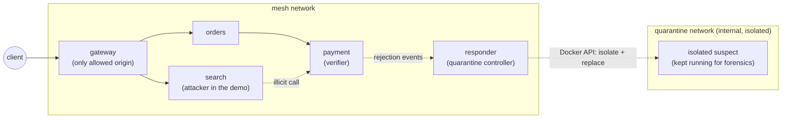
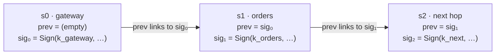
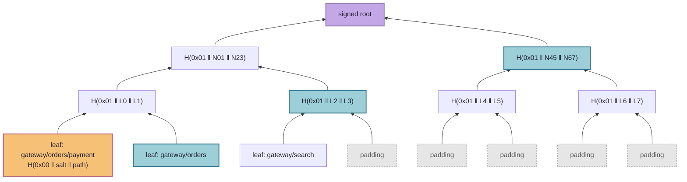
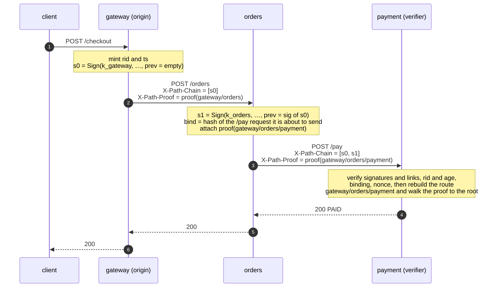
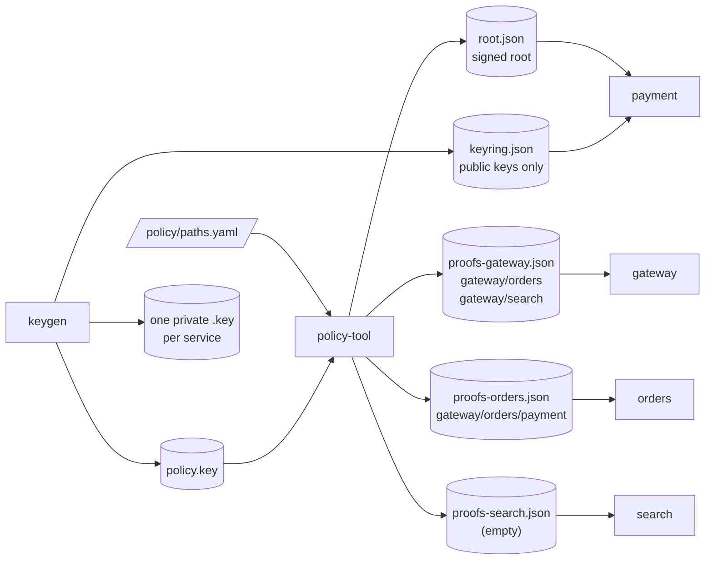
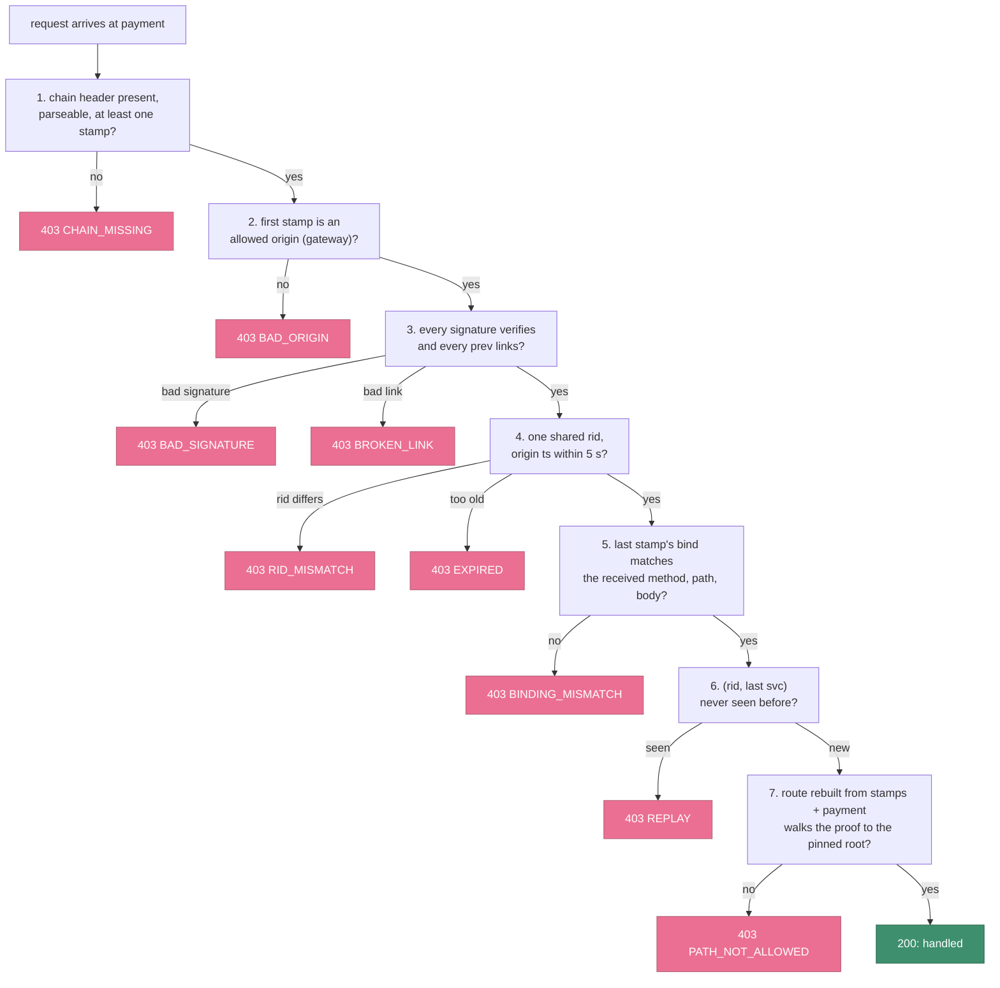
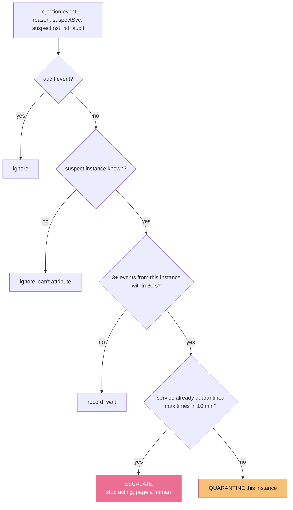
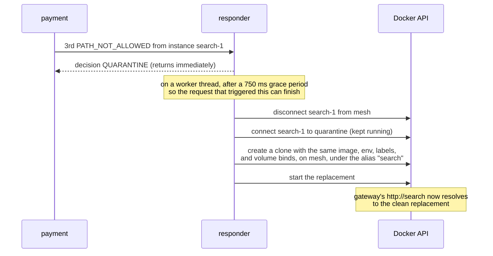

# Paztport

**A passport for requests.** The "zt" stands for zero trust.

Most security asks one question at the door: *who are you?* Paztport asks a
second question that almost nobody asks today: ***how did you get here?***

That second question matters because modern break-ins rarely come through the
front door. An attacker takes over one small, forgettable part of a system, such
as a search box, a reporting tool, or a firewall. From there they don't need to
break anything. They just *ask*. Inside a system, a request from a trusted
component looks exactly like every legitimate request, so the sensitive part (the
payment service, the customer database, the admin panel) does what it's told. In
the 2019 Capital One breach, an attacker tricked a misconfigured firewall into
fetching cloud credentials on their behalf, and the records of more than 100
million people left through a component the system trusted.

## The idea in plain terms

Think about how a passport works. Every border you cross stamps it, and customs at
your destination looks at the stamps, not just at your face. Paztport gives every
request inside a system the same kind of passport:

- **Every step stamps it** with a signature nobody else can forge. Skip a step or
  fake one, and the stamps stop lining up.
- **The destination checks the whole itinerary**, not just the last hop. A payment
  request is accepted only if it arrived by a route on the approved list.
- **The approved list stays sealed.** Each service holds a single fingerprint of
  it, so it can check a route without anyone ever seeing the full map of how the
  system fits together. That includes a partner, and an attacker who gets inside.

When a request turns up with the wrong history, it's refused. That holds even when
its credentials are valid and its contents look perfectly normal. The machine that
sent it is then moved into isolation and replaced with a clean copy, automatically,
within seconds.

## Why it matters

- **It catches the attacks that look normal.** Firewalls, passwords, and
  encrypted connections all wave through a request from a hijacked internal
  service, because it *is* an internal service. Paztport rejects it because of
  where it came from.
- **It shrinks what a break-in is worth.** A compromised component can only do
  what its legitimate position in the system allows. An attacker who takes over
  the search service gets the search service, not the payment system behind it.
- **It keeps your blueprint private.** How your systems connect is exactly the map
  an attacker wants. Paztport checks routes without ever publishing them. The same
  design is meant to let two organizations trust each other's calls without
  swapping architecture diagrams.
- **It responds on its own and keeps the evidence.** The offending machine is
  isolated, not deleted, so investigators get a live specimen while a clean
  replacement keeps the service running. If the same service keeps tripping, it
  stops and calls a human rather than risk tearing down healthy machines after a
  bad deploy.
- **It fits the AI-agent problem.** An AI assistant that reads a booby-trapped
  email and then sends your files somewhere has the same failure: a trusted
  component doing something because untrusted input asked it to. Requiring proof
  of where an action came from is a natural guardrail for agents too
  ([§15](#15-where-this-could-go)).
- **It's cheap.** Checking a request adds a fraction of a millisecond.
- **It's open.** There's no vendor and no lock-in. It's Apache-2.0 code built
  entirely on standard, well-understood cryptography.

It's also honest about its limits. Paztport doesn't make a compromised machine
trustworthy; it limits how far a compromise can travel. The full list is in
[Known limits](#14-known-limits).

## What's in this repository

A working proof of concept of **path attestation**. A request has to prove the
route it took through a system, and the destination accepts it only if that route
is one the system allows. The allowed routes are committed to a salted Merkle tree,
so a service checks a request against one signed root hash. It never holds, and
never reveals, the full map of valid paths.

It works end to end. A request with a perfectly valid body, sent by a service that
is legitimately on the network, is **rejected purely because of where it came
from**, and the offending container is **quarantined and replaced automatically**.
All ten scenarios plus a circuit-breaker check pass, and the overhead has been
measured.

The idea is offered freely. The code is Apache-2.0, and every cryptographic
primitive comes from the standard JDK, so anyone can lift it into their own stack.

---

## Contents

1. [The problem: every hop trusts only its neighbour](#1-the-problem-every-hop-trusts-only-its-neighbour)
2. [The system at a glance](#2-the-system-at-a-glance)
3. [Two proofs that bind together](#3-two-proofs-that-bind-together)
4. [A request, end to end](#4-a-request-end-to-end)
5. [Least knowledge: who holds what](#5-least-knowledge-who-holds-what)
6. [The verification pipeline](#6-the-verification-pipeline)
7. [Threat model](#7-threat-model)
8. [Security principles](#8-security-principles)
9. [Response: quarantine, not deletion](#9-response-quarantine-not-deletion)
10. [Modes and rollout](#10-modes-and-rollout)
11. [What building it taught us](#11-what-building-it-taught-us)
12. [Measurements](#12-measurements)
13. [How it compares](#13-how-it-compares)
14. [Known limits](#14-known-limits)
15. [Where this could go](#15-where-this-could-go)
16. [Running it](#16-running-it)
17. [Repository layout](#17-repository-layout)

---

## 1. The problem: every hop trusts only its neighbour

Distributed systems check trust one hop at a time. Service C verifies that
service B called it, and stops there. Nobody asks who called B.

That gap is the **confused deputy** problem. An attacker who compromises B, or
tricks it, inherits every privilege B has downstream. The malicious request looks
identical to a legitimate one: same headers, same body shape, same authenticated
caller. mTLS and SPIFFE identities make the *last hop* trustworthy and say nothing
about the hops before it.

Inspecting the payload can't catch this, because the payload is the part the
attacker controls. What the attacker rarely controls is the request's **history**.
An illicit route leaves a fingerprint even when the request itself is clean.
Paztport turns that history into a credential, and makes it unforgeable.

## 2. The system at a glance

The demo is a small mesh of four services. `payment` is the sensitive endpoint
and the verifier. `search` is reachable on the network and can call `payment`, but
its only legitimate route is `gateway → search`, so in the demo it plays the
attacker.



Allowed routes live in [`policy/paths.yaml`](policy/paths.yaml):

```yaml
paths:
  - [gateway, orders, payment]
  - [gateway, orders]
  - [gateway, search]
```

| Component | Role |
|---|---|
| `path-attest-core` | The library: stamps, chain, request binding, salted Merkle tree, verifier. Small enough to read in one sitting. |
| `path-attest-spring` | Glue: an inbound servlet filter (verify, capture context) and an outbound `RestClient` interceptor (stamp, attach proof). |
| `keygen` | One-shot job: a per-service Ed25519 keypair, a policy keypair, and the public `keyring.json`. |
| `policy-tool` | One-shot job: `paths.yaml` → salted tree → signed `root.json` plus one proof bundle per service. |
| `services/*` | Four tiny Spring Boot services. The business logic is deliberately trivial. |
| `responder` | Counts rejections and quarantines and replaces offending containers through the Docker API. |

## 3. Two proofs that bind together

A request is accepted only if it proves **two** things: that it really travelled
the route it claims (*proof of travel*), and that the route is one the system
allows (*proof of legitimacy*). Either proof alone is breakable. Together they
aren't.

### 3.1 Proof of travel: the stamp chain

Each hop appends a **stamp** to the `X-Path-Chain` header. A stamp is signed by
the hop's own Ed25519 key, and it signs over the previous stamp's signature:



| Field | Meaning |
|---|---|
| `svc` | Service name. The route is rebuilt from these. |
| `inst` | Instance (container hostname), so a response targets one replica, not a whole service. |
| `rid` | Request ID, minted by the origin and carried unchanged. |
| `ts` | Origin timestamp, carried unchanged. Stamps older than 5 s are rejected. |
| `bind` | `SHA-256(METHOD \n PATH \n BODY)` of the request *this hop sent*. |
| `prev` | The previous stamp's `sig`; empty at the origin. |
| `sig` | Ed25519 signature over the canonical bytes `svc\|inst\|rid\|ts\|bind\|prev`. |

Why it's built this way:

- **Chaining through `prev = sig`** makes the chain tamper-evident in the same way a
  hash chain is. Remove, reorder, or insert a stamp and some `prev` stops matching,
  or some signature stops verifying.
- **Ed25519 rather than an HMAC** means verifiers need only *public* keys. No
  shared secret is ever distributed, and a compromised verifier can't forge stamps.
- **The request binding** ties the chain to the actual payload. The receiver
  recomputes `bind` from the request it got and compares it to the **last** stamp.
  A chain copied from a real request and spliced onto a malicious body no longer
  matches.
- **`rid` + `ts` + a nonce cache** stop replays. The `(rid, last svc)` pair can be
  accepted once, and the 5 s freshness window bounds how long anything needs to be
  remembered.

### 3.2 Proof of legitimacy: the salted Merkle tree

The allowed routes are hashed into a Merkle tree. A service pins only the
**root**, one 32-byte hash that stands for the entire policy, signed by a policy
key. A request carries an `X-Path-Proof`: the sibling hashes from its route's leaf
up to the root.



*Illustrative depth-3 tree. The proof for the orange leaf is the three blue
siblings; the verifier recomputes upward and compares against the pinned root.
The real tree is padded to depth 8.*

The details carry real weight:

- **Leaf** = `SHA-256(0x00 ‖ salt ‖ "gateway/orders/payment")`.
  **Node** = `SHA-256(0x01 ‖ left ‖ right)`. The `0x00` / `0x01` domain-separation
  prefixes are mandatory. Without them, a 64-byte internal node could be passed off
  as a leaf: the classic Merkle second-preimage attack.
- **Every leaf has a secret 128-bit salt.** Real path spaces are tiny, so an
  unsalted `gateway/orders/payment` could be confirmed by hashing a handful of
  guesses. With salts, sibling hashes and the root reveal nothing an observer can
  test guesses against. §8 explains why this is a hard rule, not a preference.
- **Proofs are padded to a fixed depth** (8 levels, 256 leaf slots). Unused slots
  are filled with random 32-byte values that look like any other hash. Proof
  length therefore leaks nothing about how many routes exist.
- **The root is signed** by the policy key over `rootId | root`. A widened policy
  can't be swapped in without that key. The `rootId` is derived from the policy
  *content* (`v` + 12 hex chars of SHA-256 over the route list), so it's a stable
  label for a given policy even though fresh salts change the root bytes on every
  build.

### 3.3 Why you need both

- **Stamps alone** prove the travel but not its legitimacy. The verifier would
  need the full list of allowed routes, which reveals the map and has to be
  distributed everywhere. Without a policy check, any well-signed chain from a valid
  origin would pass.
- **Merkle proofs alone** prove that *some* route is allowed, not that *this
  request* took it. An attacker could claim a perfectly valid route and attach a
  proof for it.

The binding between the two is one rule: **the verifier rebuilds the route from the
authenticated `svc` fields in the stamps, never from any claimed field.** It
appends its own name, then checks *that* route against the root. You can't claim a
route you didn't travel, and you can't travel a route that isn't in the tree.

### 3.4 On the wire

`path-attest-core` is the reference implementation of this format. Binary values
are **base64url without padding**, and both headers are base64url-encoded JSON.

`X-Path-Chain` is a JSON array of stamps, origin first:

```json
[{ "svc": "...", "inst": "...", "rid": "...", "ts": 0,
   "bind": "<b64url>", "prev": "<b64url>", "sig": "<b64url>" }]
```

- `sig` signs the UTF-8 bytes `svc|inst|rid|ts|bind|prev`, joined with `|`, with
  `ts` in decimal.
- `prev` is the previous stamp's `sig` as base64url, or the empty string at the
  origin.
- `bind` is `b64url(SHA-256(METHOD \n PATH \n BODY))` of the request this hop sent.

`X-Path-Proof` proves membership for the full route, **including the receiving
service**:

```json
{ "leafSalt": "<b64url>", "siblings": ["<b64url>", ...], "dirs": "LRL...", "rootId": "..." }
```

`dirs[i]` is `L` when the working hash is the left input at level `i`, and `R`
otherwise.

The signed root (`root.json`) that verifiers pin:

```json
{ "rootId": "...", "root": "<b64url>", "sig": "<b64url>" }
```

`sig` is the policy key's Ed25519 signature over `rootId|root`.

## 4. A request, end to end



Application code never touches any of this. The outbound interceptor stamps
every `RestClient` call. It takes the target service from the request URI host
(Compose service names double as hostnames), takes the inbound chain from a
request-scoped context, and attaches the proof for `(chain so far) + target` if
this hop holds one. The inbound filter caches the body, records the received chain
for later appends, and runs verification on verifying services.

## 5. Least knowledge: who holds what

Each route's proof goes to exactly one place: that route's **second-to-last hop**,
because that hop attaches it when calling the last hop. Least knowledge is enforced
by *distribution*, not just by policy.



| Component | Holds | Never holds |
|---|---|---|
| gateway / orders | Own private key; own proof bundle | Other services' keys, the tree, any salts but its own proofs' |
| payment (verifier) | Public keyring, signed root, nonce cache | Any private key, the tree, salts, proofs |
| search | Own private key; an **empty** bundle | Any proof for a route ending at `payment`, because none exists |
| policy-tool | The full tree and every salt | Nothing is mounted *from* it into services |

In Compose this is enforced with per-file bind mounts. Each container sees only the
specific files its role needs, never a shared volume of all keys.

The heart of the demo is `search`'s empty bundle. `search` can reach `payment` on
the network and can sign stamps with its own key. It was never given a proof for a
route to `payment`, and it can't make one: the route `gateway/search/payment` isn't
a leaf, and collision resistance means no sibling set will walk a non-leaf up to
the root.

## 6. The verification pipeline

`payment` runs a fixed sequence of checks and fails closed at the first one that
doesn't hold:



Notes on the ordering:

- The order is deliberate. Cheap structural checks run first. The signatures run
  before anything trusts a field. Freshness and binding run before the replay cache
  is touched, which is why a body altered on a replayed request reports
  `BINDING_MISMATCH` and an aged one reports `EXPIRED`.
- A missing or unparseable **proof** gives `PATH_NOT_ALLOWED`, not `CHAIN_MISSING`:
  without a valid proof you can't show membership. `CHAIN_MISSING` is reserved for
  the chain.
- **Step 8**, which checks that the last stamp's `svc` matches the real transport
  caller, needs mTLS and isn't implemented yet. It's a documented gap (see §14).
- Every rejection returns a 403 with the reason code and publishes an event for
  the responder.

## 7. Threat model

**The attacker** fully controls one service (`search` in the demo). That includes
its private key, its network position, and every header it receives. The network
lets it call `payment` directly; there is no NetworkPolicy to hide behind. It
does **not** have other services' private keys or the policy key. Its goal is to
get `payment` to act on a request.

| Attack | What stops it | Demo scenario |
|---|---|---|
| Call `payment` with no attestation | Fail closed: missing chain is invalid, never "legacy traffic" | 2: `CHAIN_MISSING` |
| Forge a stamp claiming to be `gateway` | Verified against gateway's public key, which the attacker can't sign for | 3: `BAD_SIGNATURE` |
| Forward a real chain it legitimately received | Route rebuilt from stamps (`gateway/search/payment`) is not a leaf | 4: `PATH_NOT_ALLOWED` |
| Replay a captured valid request | `(rid, last svc)` nonce already spent | 5: `REPLAY` |
| Keep a valid chain, swap the body | Last stamp's `bind` no longer matches | 6: `BINDING_MISMATCH` |
| Hold a chain and use it later | Origin `ts` older than the freshness window | 7: `EXPIRED` |
| Keep attacking | Instance isolated and replaced after a threshold | 9: quarantine |

**Not defended by design:** a compromised hop that sits on a *valid* route can
still misuse that route. If `orders` were compromised, it could alter what it sends
to `payment`. It would sign the altered request itself, so the misuse is
attributable to it, but it isn't prevented. Attestation constrains **position**,
not **trustworthiness**. The practical result is that lateral movement becomes
*positional*: a compromised node can do only what its legitimate place in the
graph allows.

## 8. Security principles

**Security must come from secrets, never from effort.** No part of Paztport's
security may depend on an attacker having to hash more than honest parties do.

This is a law, not a habit. Barak and Mahmoody,
*["Merkle's Key Agreement Protocol is Optimal"](https://arxiv.org/abs/0801.3669)*
(CRYPTO 2009), prove that in a hash-only world (the random-oracle model, with no
other assumptions) honest parties can get **at most a quadratic** advantage over
an attacker. If the honest side makes `n` queries, an attacker succeeds in `O(n²)`.
Read it as a **conservation law for cryptographic asymmetry**: you can't
manufacture a super-polynomial gap out of hashing effort. Any real asymmetry has to
be *imported* from something the theorem doesn't cover, either a **secret** the
attacker lacks or a **structured hardness assumption**.

Paztport sits on the right side of that line:

- Stamps are **Ed25519**, which rests on discrete log, a structured and
  super-polynomial assumption.
- Route confidentiality rests on **128-bit secret salts**. Guessing a salted leaf
  means brute-forcing the salt, roughly `2¹²⁸` work. That is a secret, not a
  hashing race.
- Integrity (binding, replay, Merkle) rests on SHA-256's preimage and collision
  resistance, which is again structured hardness.

The one place the bound would bite is exactly what's forbidden: unsalted leaves. A
tiny path space plus "just hash harder" can never be secure. There's no unsalted
leaf code path anywhere in the codebase, tests included. The quantum view agrees:
Grover gives only a quadratic speedup against hashes, while Shor breaks Ed25519
outright, which is why the post-quantum plan (§15) keeps the Merkle tree and swaps
only the signatures.

The rest of the principles follow the same discipline:

- **Fail closed.** Any parse error, missing header, unknown key, or expired stamp
  is a rejection. Stripping the header must never become an escape hatch.
- **Only entry points start chains.** The first stamp must come from a key only
  real ingress holds. A compromised internal service can't forge the gateway's
  signature.
- **Never trust a claimed field.** The route is always rebuilt from authenticated
  stamps.
- **Log identities and verdicts, never secrets.** Service IDs, request IDs, and
  reason codes appear in logs. Private keys, salts, and proof bundles never do.

## 9. Response: quarantine, not deletion

The chain shows exactly where a route stopped being valid, so the response can
target **one instance** rather than a whole service. Docker has no ReplicaSet, so
the `responder` plays that role through the Docker socket.

The decision logic is a small pure function, unit-tested without Docker:



The action is then carried out asynchronously:



Why each piece is there:

- **Quarantine, don't delete.** The suspect moves to an isolated network and keeps
  running, so you keep a live specimen for forensics while a clean replacement
  serves traffic.
- **Attribute to the instance.** Stamps carry the container hostname, so the
  responder isolates one replica, not every pod in the service.
- **Require a threshold** (3 in 60 s). One bad event doesn't trigger action, and
  audit-mode events never do.
- **Circuit breaker** (by default at most 2 quarantines per service per 10 min).
  If a deploy adds a legitimate route before the root is updated, every pod on it
  looks guilty. Past the limit the responder stops acting and logs `ESCALATE`.
  Repeated quarantines of one service are also the **reinfection signal**: if the
  replacement is flagged again, the image or an input is the problem, not the pod.

## 10. Modes and rollout

Each verifying service runs in one of three modes (`PATH_ATTEST_MODE`):

| Mode | Verifies | Rejects | Use |
|---|---|---|---|
| `off` | no | no | Latency baseline |
| `audit` | yes, logs events marked `audit=true` | no | Measure the false-positive rate on real traffic |
| `enforce` | yes | yes, with a 403 | Protection |

`audit` is the on-ramp for an existing system. You run it against real traffic,
measure how often retries, health checks, and batch jobs trip it, fix the policy,
then flip individual endpoints to `enforce`. The responder ignores audit events, so
nothing gets quarantined while you're learning.

## 11. What building it taught us

Some of the most useful results came from running the system live, not from the
unit tests. Each of these was root-caused before it was fixed:

- **The quarantine severed the request that triggered it.** The first responder
  acted synchronously inside the event POST. But the suspect was *part of the
  call chain* that produced the event (`demo → search → payment → responder`), so
  pulling it off the network mid-request meant `payment`'s 403 could never be
  delivered back. The triggering call hung. Fix: decide synchronously, act
  asynchronously after a short grace period. The general lesson: **a response
  system must never sit inside the path of the thing it's responding to.**
- **Fresh salts mean fresh root bytes, so every holder reloads together.** The
  `rootId` stays stable for a given policy, but each `policy-tool` run draws new
  salts and the root bytes change. If you restart only the verifier, the callers
  still hold proofs for the old tree and every legitimate request fails. Policy
  rollout has to be atomic across every holder. That's a miniature of the "policy
  drift" problem real deployments will face.
- **Control-plane endpoints must bypass the data-plane check.** The inbound filter
  first verified *every* path, including the admin and debug endpoints, and
  rejected them for lacking a chain. Attestation applies to the attested data path,
  not to the control plane.
- **Infrastructure the responder needs has to be created by the responder.**
  Compose doesn't create a network that no service joins, and a container created
  with networking disabled can't then join a network. Both were caught only by
  watching real Docker API errors.

## 12. Measurements

Measured on a single host (Apple Silicon, Docker Desktop, JDK 21) with k6 driving
the legitimate path (10 virtual users for 20 s, via
[scripts/measure.sh](scripts/measure.sh)). `payment` is toggled between `off` and
`enforce` with everything else identical, so the difference is the cost of
verification.

| | p50 | p99 |
|---|---|---|
| `payment` in `off` | 3.57 ms | 6.43 ms |
| `payment` in `enforce` | 3.86 ms | 5.39 ms |

| Operation | Cost |
|---|---|
| Merkle proof verify (depth 8) | **1.6 µs** |
| SHA-256 (one stamp) | 0.09 µs |
| Ed25519 sign / verify (stock JDK) | ~222 / ~226 µs |
| Headers at chain depth 2 | 814 B chain + 615 B proof = **1.4 KB** |

What the numbers say:

- **Verification adds about 0.3 ms**, which is within run-to-run noise on a
  ~3.6 ms request. The HTTP hops dominate.
- **The proof of legitimacy is effectively free.** All the cost is in the
  signature chain, one Ed25519 verify per hop.
- **Stock JDK Ed25519 is the slow part.** It runs about 5–10× slower than
  optimized native implementations, which do tens of microseconds. A hot-path
  deployment would swap the signature implementation; the Merkle machinery
  wouldn't change.
- **Headers grow about 407 B per hop.** The proof is a fixed 615 B whatever the
  route length.

Caveats:

- **Single host, loopback networking.** These numbers show feasibility. They
  aren't a production SLA.
- **`off` vs `enforce` isolates verification, not stamping.** Callers stamp in
  both modes, and each stamp costs one Ed25519 sign (about 0.22 ms per outbound
  call). Only `payment` verifies in this topology, so a design that verifies at
  every hop multiplies the verify cost by the number of verifying hops.
- **Micro-benchmarks are JIT-warmed.** Cold starts pay JIT and class-loading costs
  that aren't reflected here.
- **The false-positive rate isn't measured.** Retries, health checks, and batch
  jobs need real traffic in `audit` mode, and this local POC doesn't generate any.

## 13. How it compares

The pieces exist, scattered across observability, service meshes, and token
research. None of them combines proof of route with a private policy of valid
routes.

| Approach | What it proves | Where it stops |
|---|---|---|
| Distributed tracing (OpenTelemetry, `traceparent`) | The path a request *claims* to have taken | Unauthenticated headers, trivially forged or stripped |
| Per-hop identity (mTLS, SPIFFE, Istio, Linkerd) | Who the immediate caller is | One hop deep, no knowledge of the chain |
| Network policies (Calico, Cilium) | Which pod may reach which pod | Edge-level allow lists, no request context |
| Macaroons | A chained HMAC that holders can only restrict | Attenuates authority; doesn't attest a route |
| OAuth Transaction Tokens (IETF draft) | Original caller and purpose, carried along | Context propagation, not hop-by-hop proof |
| SCION, OPT | Packet-level path verification | Network layer, needs new routing infrastructure |
| Trace-based anomaly detection | Statistically unusual call graphs | Probabilistic, no cryptographic guarantee |

Paztport borrows chaining from macaroons, identity from the mesh, and learned
paths from tracing, and adds the piece none of them has: a **cryptographic proof
that the route taken is in a private, committed policy**.

## 14. Known limits

- **Position, not trust.** A compromised hop on a valid route can still misuse
  that route (see §7).
- **The caller-identity check is advisory without mTLS.** Until mTLS binds the last
  stamp to the real transport identity, verification step 8 is a gap.
- **Proof linkability.** A route's proof is byte-identical on every request, so an
  observer who sees many proofs can cluster requests by route and count distinct
  and frequent routes without breaking any cryptography. Inside one mesh, mTLS
  hides headers in transit, so the exposure is mainly to compromised nodes. Across
  organizations a partner sees every proof, which makes this a real privacy gap.
  Zero-knowledge membership proofs, whose output differs on every request, would
  close it.
- **Async is out of scope.** Queues, caches, and scheduled jobs break the
  linear-chain model.
- **The responder mounts the Docker socket**, which is host-level control.
  Acceptable for a local demo only; never do this in a real deployment.
- **The nonce cache is in-memory and unbounded** in this POC. The freshness window
  means it only *needs* to remember about 5 s of requests, and a real deployment
  would use a shared, expiring store.
- **The demo includes a replay harness.** `payment` can retain its last request
  (`/debug/last-request`, only when `PA_CAPTURE=true`) so the demo can replay and
  mutate a genuinely valid request. It simulates an on-the-wire capture and isn't
  part of the attestation model.

## 15. Where this could go

These are design directions, not implementations.

- **Post-quantum.** Keep the Merkle tree and swap Ed25519 stamps for hash-based
  signatures. SLH-DSA (FIPS 205) is stateless, but at ~8–50 KB per signature it's
  too large for per-hop headers today. XMSS and LMS are smaller but stateful, and
  reusing a key is catastrophic. Signing isn't behind a swap interface yet.
  Making it swappable would take a `StampSigner` / `StampVerifier` interface, an
  algorithm tag in `keyring.json` and alongside each `sig`, and, for XMSS or LMS, a
  signer with persisted key state. The interface is cheap; managing stateful keys
  and living with the header sizes is the real work.
- **AI agents and MCP.** Prompt injection *is* the confused-deputy problem. A path
  becomes a sequence of steps (`user → orchestrator → subagent → tool`, or
  `read_inbox → summarize → send_email`), and the agent *runtime*, not the model,
  holds the keys and stamps each step. A sensitive MCP server could require a chain
  proving a call began in a user session and went only through approved agents,
  without the client revealing its agent architecture.
- **Async boundaries.** Treat a queue like another organization: attest and
  summarize at enqueue, carry a compact signed commitment plus the broker's message
  ID, and let the message ID replace the timestamp as the anti-replay key. Fan-in
  (joins) is the open frontier and likely needs its own commitment structure.
- **Scale.** A forest of sub-roots partitioned by destination keeps every proof at
  `log(subtree)` no matter how large the global path space gets. It also shrinks the
  blast radius of a policy change to one domain. Further out, the policy could be
  modelled as a sparse route operator (forward is `A`, backward is `Aᵀ`) committed
  with polynomial commitments for constant-size proofs.
- **Interrupted work and race conditions.** A quarantined node can't be trusted to
  hand off its own work. The trusted party is the origin, which can mint a
  retry (same `rid`, `attempt + 1`) that a replayer can't forge. The same
  verifiable `rid` could own leases on declared intent keys, giving path-scoped
  concurrency control at the attested boundary.
- **Cross-organization trust.** Publish signed roots, never trees. An egress
  gateway verifies the internal chain and emits one boundary attestation, and an
  append-only log of roots (in the style of Certificate Transparency) lets partners
  detect a quietly widened policy without seeing its contents.

## 16. Running it

**Prerequisites:** JDK 21 or newer, Maven, Docker with Compose.

```bash
mvn -q package -DskipTests              # build every module
docker compose build keygen policy-tool # package the freshly built jars
docker compose run --rm keygen          # per-service keys + keyring
docker compose run --rm policy-tool     # signed root + per-service proof bundles
docker compose up -d --build            # the mesh + responder
./scripts/demo.sh                       # run every scenario, print pass/fail
./scripts/measure.sh                    # optional: off vs enforce latency + header sizes
```

`docker compose run` reuses an existing image and never rebuilds it. If you
change and rebuild the Java code, run `docker compose build keygen policy-tool`
again before generating keys or policy. Otherwise the old jars run, and you get
output in the old format, for example private keys that aren't owner-only.
`up --build` rebuilds the mesh services itself. Private key files are written
owner-read/write only (`0600`).

`demo.sh` is idempotent. It cleans up any replacement containers, restores the
original policy, rebuilds the root, resets the mode to `enforce`, and runs:

| # | Scenario | Expected |
|---|---|---|
| 1 | client → gateway → orders → payment | 200 |
| 2 | search calls payment with no headers | 403 `CHAIN_MISSING` |
| 3 | search forges a stamp claiming to be gateway | 403 `BAD_SIGNATURE` |
| 4 | search forwards a real `gateway→search` chain to payment | 403 `PATH_NOT_ALLOWED` |
| 5 | a captured valid request is replayed | 403 `REPLAY` |
| 6 | valid chain, body altered after the last stamp | 403 `BINDING_MISMATCH` |
| 7 | a chain older than the max age | 403 `EXPIRED` |
| 8 | scenarios 2–4 in `audit` mode | 200, events logged, no quarantine |
| 9 | three illicit calls from search in `enforce` | search isolated; a fresh search serves `gateway→search` |
| 9b | another round past the per-service limit | responder logs `ESCALATE` |
| 10 | add `[gateway, search, payment]`, rebuild root | scenario 4 now returns 200: policy drives behaviour |

The attacks run inside the mesh, from `search`'s `/attack/*` endpoints (enabled
only when `ATTACK_MODE=true`). Only the gateway port is exposed to the host.

The agent demo is separate and needs Node 22.19+ and Ollama: from `agents/`, `npm run demo` opens a local page for one run ([agents/demo-ui](agents/demo-ui/README.md)).
`npm run eval -- --model ollama/<model>` repeats the runs and writes a results table ([agents/eval](agents/eval/README.md)).

**Configuration**

| Variable | Default | Used by |
|---|---|---|
| `PATH_ATTEST_MODE` | `enforce` | verifiers (`off`, `audit`, `enforce`) |
| `PATH_ATTEST_MAX_AGE_MS` | `5000` | verifiers |
| `PATH_ATTEST_ORIGINS` | `gateway` | verifiers |
| `PATH_ATTEST_PROOF_DEPTH` | `8` | policy-tool |
| `ATTACK_MODE` | `false` | search |
| `RESPONDER_URL` | empty, so events are only logged | verifiers (the demo sets it for scenario 9) |
| `QUARANTINE_THRESHOLD` | `3` | responder |
| `QUARANTINE_MAX_PER_SVC` | `2` | responder (the demo uses `1` so `ESCALATE` comes sooner) |

## 17. Repository layout

```
paztport/
├── LICENSE, NOTICE           Apache-2.0, copyright
├── THIRD-PARTY.txt           runtime dependencies and their licenses (generated)
├── policy/paths.yaml         allowed routes
├── path-attest-core/         stamps, chain, binding, salted Merkle tree, verifier
├── path-attest-spring/       inbound filter, outbound interceptor, modes, events
├── keygen/                   per-service keypairs + keyring
├── policy-tool/              paths.yaml → signed root + per-service bundles
├── services/                 gateway, orders, payment, search
├── responder/                quarantine controller (docker-java)
├── agents/                   TS protocol library + policy CLIs (agent/MCP demo, in progress)
│   ├── mock-github-mcp/      mock GitHub MCP server (+ docs server), stdio, demo agent target
│   ├── pi-extension/         pi extension: stamps MCP calls, verifies responses, tracks influence
│   ├── eval/                 runs the agent many times per setting, scores from the outcome log, verify
│   ├── demo-ui/              local web page: one run at a time, evidence per call, results folders
│   └── scenarios/            scenario folders: repositories, planted text, scoring data
└── scripts/
    ├── demo.sh               every scenario, pass/fail table
    ├── measure.sh            off vs enforce latency, header sizes
    └── load.js               k6 load script
```

## License and third-party software

Copyright 2026 The Paztport Authors. Licensed under Apache-2.0 (see
[LICENSE](LICENSE) and [NOTICE](NOTICE)). Its explicit patent grant protects
everyone who builds on this, including commercially. The idea is meant to stay
open: anyone can implement, extend, or sell path attestation, and the only
request is that improvements flow back into the open where they can.

The source repository bundles no third-party code. Built artifacts do, and
[THIRD-PARTY.txt](THIRD-PARTY.txt) lists every runtime dependency with its license.
All of them are permissive (Apache-2.0, MIT, the MIT-style Bouncy Castle licence)
or weak copyleft that is fine to redistribute unmodified (Logback, JNA, Jakarta
Annotations). Regenerate the list after changing dependencies:

```bash
mvn license:aggregate-add-third-party
```

Bouncy Castle appears in the build only because `docker-java` uses it for Docker
TLS in the responder. None of Paztport's own cryptography uses it; stamps,
hashing, and salts all come from the JDK.
