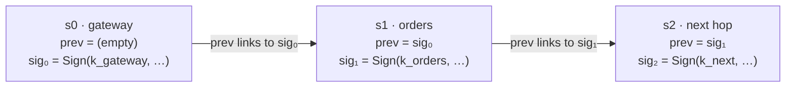
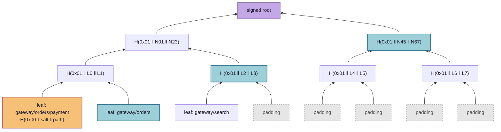

# Paztport

**A passport for requests.** The "zt" stands for zero trust.

Most security asks one question at the door: *who are you?* Paztport asks a
second question that almost nobody asks today: ***how did you get here?***

That second question matters because modern break-ins rarely come through the
front door. An attacker takes over one small, forgettable part of a system, such
as a search box, a reporting tool, or a firewall. From there they don't need to
break anything. They just *ask*. Inside a system, a request from a trusted
component looks exactly like every legitimate request, so the sensitive part (the
payment service, the customer database, the admin panel) does what it's told. In
the 2019 Capital One breach, an attacker tricked a misconfigured firewall into
fetching cloud credentials on their behalf, and the records of more than 100
million people left through a component the system trusted.

## The idea in plain terms

Think about how a passport works. Every border you cross stamps it, and customs at
your destination looks at the stamps, not just at your face. Paztport gives every
request inside a system the same kind of passport:

- **Every step stamps it** with a signature nobody else can forge. Skip a step or
  fake one, and the stamps stop lining up.
- **The destination checks the whole itinerary**, not just the last hop. A payment
  request is accepted only if it arrived by a route on the approved list.
- **The approved list stays sealed.** Each service holds a single fingerprint of
  it, so it can check a route without anyone ever seeing the full map of how the
  system fits together. That includes a partner, and an attacker who gets inside.

When a request turns up with the wrong history, it's refused. That holds even when
its credentials are valid and its contents look perfectly normal. The machine that
sent it is then moved into isolation and replaced with a clean copy, automatically,
within seconds.

## Why it matters

- **It catches the attacks that look normal.** Firewalls, passwords, and
  encrypted connections all wave through a request from a hijacked internal
  service, because it *is* an internal service. Paztport rejects it because of
  where it came from.
- **It shrinks what a break-in is worth.** A compromised component can only do
  what its legitimate position in the system allows. An attacker who takes over
  the search service gets the search service, not the payment system behind it.
- **It keeps your blueprint private.** How your systems connect is exactly the map
  an attacker wants. Paztport checks routes without ever publishing them. The same
  design is meant to let two organizations trust each other's calls without
  swapping architecture diagrams.
- **It responds on its own and keeps the evidence.** The offending machine is
  isolated, not deleted, so investigators get a live specimen while a clean
  replacement keeps the service running. If the same service keeps tripping, it
  stops and calls a human rather than risk tearing down healthy machines after a
  bad deploy.
- **It fits the AI-agent problem.** An AI assistant that reads a booby-trapped
  email and then sends your files somewhere has the same failure: a trusted
  component doing something because untrusted input asked it to. Requiring proof
  of where an action came from is a natural guardrail for agents too
  ([§6](#6-where-this-could-go)).
- **It's cheap.** Checking a request adds a fraction of a millisecond.
- **It's open.** There's no vendor and no lock-in. It's Apache-2.0 code built
  entirely on standard, well-understood cryptography.

It's also honest about its limits. Paztport doesn't make a compromised machine
trustworthy; it limits how far a compromise can travel. The full list is in
[Known limits](#5-known-limits).

## What's in this repository

A working proof of concept of **path attestation**. A request has to prove the
route it took through a system, and the destination accepts it only if that route
is one the system allows. The allowed routes are committed to a salted Merkle tree,
so a service checks a request against one signed root hash. It never holds, and
never reveals, the full map of valid paths.

It works end to end. In the [Java mesh demo](poc-demos/java-mesh/README.md), a
request with a perfectly valid body, sent by a service that is legitimately on the
network, is **rejected purely because of where it came from**, and the offending
container is **quarantined and replaced automatically**. All ten scenarios plus a
circuit-breaker check pass, and the overhead has been measured.

The idea is offered freely. The code is Apache-2.0, and every cryptographic
primitive comes from the standard JDK, so anyone can lift it into their own stack.

---

## Contents

1. [The problem: every hop trusts only its neighbour](#1-the-problem-every-hop-trusts-only-its-neighbour)
2. [Two proofs that bind together](#2-two-proofs-that-bind-together)
3. [Security principles](#3-security-principles)
4. [How it compares](#4-how-it-compares)
5. [Known limits](#5-known-limits)
6. [Where this could go](#6-where-this-could-go)
7. [Running it](#7-running-it)
8. [Repository layout](#8-repository-layout)
9. [Where to go next](#9-where-to-go-next)

---

## 1. The problem: every hop trusts only its neighbour

Distributed systems check trust one hop at a time. Service C verifies that
service B called it, and stops there. Nobody asks who called B.

That gap is the **confused deputy** problem. An attacker who compromises B, or
tricks it, inherits every privilege B has downstream. The malicious request looks
identical to a legitimate one: same headers, same body shape, same authenticated
caller. mTLS and SPIFFE identities make the *last hop* trustworthy and say nothing
about the hops before it.

Inspecting the payload can't catch this, because the payload is the part the
attacker controls. What the attacker rarely controls is the request's **history**.
An illicit route leaves a fingerprint even when the request itself is clean.
Paztport turns that history into a credential, and makes it unforgeable.

## 2. Two proofs that bind together

A request is accepted only if it proves **two** things: that it really travelled
the route it claims (*proof of travel*), and that the route is one the system
allows (*proof of legitimacy*). Either proof alone is breakable. Together they
aren't.

### 2.1 Proof of travel: the stamp chain

Each hop appends a **stamp** to the `X-Path-Chain` header. A stamp is signed by
the hop's own Ed25519 key, and it signs over the previous stamp's signature:



| Field | Meaning |
|---|---|
| `svc` | Service name. The route is rebuilt from these. |
| `inst` | Instance (container hostname), so a response targets one replica, not a whole service. |
| `rid` | Request ID, minted by the origin and carried unchanged. |
| `ts` | Origin timestamp, carried unchanged. Stamps older than 5 s are rejected. |
| `bind` | `SHA-256(METHOD \n PATH \n BODY)` of the request *this hop sent*. |
| `prev` | The previous stamp's `sig`; empty at the origin. |
| `sig` | Ed25519 signature over the canonical bytes `svc\|inst\|rid\|ts\|bind\|prev`. |

Why it's built this way:

- **Chaining through `prev = sig`** makes the chain tamper-evident in the same way a
  hash chain is. Remove, reorder, or insert a stamp and some `prev` stops matching,
  or some signature stops verifying.
- **Ed25519 rather than an HMAC** means verifiers need only *public* keys. No
  shared secret is ever distributed, and a compromised verifier can't forge stamps.
- **The request binding** ties the chain to the actual payload. The receiver
  recomputes `bind` from the request it got and compares it to the **last** stamp.
  A chain copied from a real request and spliced onto a malicious body no longer
  matches.
- **`rid` + `ts` + a nonce cache** stop replays. The `(rid, last svc)` pair can be
  accepted once, and the 5 s freshness window bounds how long anything needs to be
  remembered.

### 2.2 Proof of legitimacy: the salted Merkle tree

The allowed routes are hashed into a Merkle tree. A service pins only the
**root**, one 32-byte hash that stands for the entire policy, signed by a policy
key. A request carries an `X-Path-Proof`: the sibling hashes from its route's leaf
up to the root.



*Illustrative depth-3 tree. The proof for the orange leaf is the three blue
siblings; the verifier recomputes upward and compares against the pinned root.
The real tree is padded to depth 8.*

The details carry real weight:

- **Leaf** = `SHA-256(0x00 ‖ salt ‖ "gateway/orders/payment")`.
  **Node** = `SHA-256(0x01 ‖ left ‖ right)`. The `0x00` / `0x01` domain-separation
  prefixes are mandatory. Without them, a 64-byte internal node could be passed off
  as a leaf: the classic Merkle second-preimage attack.
- **Every leaf has a secret 128-bit salt.** Real path spaces are tiny, so an
  unsalted `gateway/orders/payment` could be confirmed by hashing a handful of
  guesses. With salts, sibling hashes and the root reveal nothing an observer can
  test guesses against. §3 explains why this is a hard rule, not a preference.
- **Proofs are padded to a fixed depth** (8 levels, 256 leaf slots). Unused slots
  are filled with random 32-byte values that look like any other hash. Proof
  length therefore leaks nothing about how many routes exist.
- **The root is signed** by the policy key over `rootId | root`. A widened policy
  can't be swapped in without that key. The `rootId` is derived from the policy
  *content* (`v` + 12 hex chars of SHA-256 over the route list), so it's a stable
  label for a given policy even though fresh salts change the root bytes on every
  build.

### 2.3 Why you need both

- **Stamps alone** prove the travel but not its legitimacy. The verifier would
  need the full list of allowed routes, which reveals the map and has to be
  distributed everywhere. Without a policy check, any well-signed chain from a valid
  origin would pass.
- **Merkle proofs alone** prove that *some* route is allowed, not that *this
  request* took it. An attacker could claim a perfectly valid route and attach a
  proof for it.

The binding between the two is one rule: **the verifier rebuilds the route from the
authenticated `svc` fields in the stamps, never from any claimed field.** It
appends its own name, then checks *that* route against the root. You can't claim a
route you didn't travel, and you can't travel a route that isn't in the tree.

The headers' exact encoding is in [poc-sdks](poc-sdks/README.md#on-the-wire).

## 3. Security principles

**Security must come from secrets, never from effort.** No part of Paztport's
security may depend on an attacker having to hash more than honest parties do.

This is a law, not a habit. Barak and Mahmoody,
*["Merkle's Key Agreement Protocol is Optimal"](https://arxiv.org/abs/0801.3669)*
(CRYPTO 2009), prove that in a hash-only world (the random-oracle model, with no
other assumptions) honest parties can get **at most a quadratic** advantage over
an attacker. If the honest side makes `n` queries, an attacker succeeds in `O(n²)`.
Read it as a **conservation law for cryptographic asymmetry**: you can't
manufacture a super-polynomial gap out of hashing effort. Any real asymmetry has to
be *imported* from something the theorem doesn't cover, either a **secret** the
attacker lacks or a **structured hardness assumption**.

Paztport sits on the right side of that line:

- Stamps are **Ed25519**, which rests on discrete log, a structured and
  super-polynomial assumption.
- Route confidentiality rests on **128-bit secret salts**. Guessing a salted leaf
  means brute-forcing the salt, roughly `2¹²⁸` work. That is a secret, not a
  hashing race.
- Integrity (binding, replay, Merkle) rests on SHA-256's preimage and collision
  resistance, which is again structured hardness.

The one place the bound would bite is exactly what's forbidden: unsalted leaves. A
tiny path space plus "just hash harder" can never be secure. There's no unsalted
leaf code path anywhere in the codebase, tests included. The quantum view agrees:
Grover gives only a quadratic speedup against hashes, while Shor breaks Ed25519
outright, which is why the post-quantum plan (§6) keeps the Merkle tree and swaps
only the signatures.

The rest of the principles follow the same discipline:

- **Fail closed.** Any parse error, missing header, unknown key, or expired stamp
  is a rejection. Stripping the header must never become an escape hatch.
- **Only entry points start chains.** The first stamp must come from a key only
  real ingress holds. A compromised internal service can't forge the gateway's
  signature.
- **Never trust a claimed field.** The route is always rebuilt from authenticated
  stamps.
- **Log identities and verdicts, never secrets.** Service IDs, request IDs, and
  reason codes appear in logs. Private keys, salts, and proof bundles never do.

## 4. How it compares

The pieces exist, scattered across observability, service meshes, and token
research. None of them combines proof of route with a private policy of valid
routes.

| Approach | What it proves | Where it stops |
|---|---|---|
| Distributed tracing (OpenTelemetry, `traceparent`) | The path a request *claims* to have taken | Unauthenticated headers, trivially forged or stripped |
| Per-hop identity (mTLS, SPIFFE, Istio, Linkerd) | Who the immediate caller is | One hop deep, no knowledge of the chain |
| Network policies (Calico, Cilium) | Which pod may reach which pod | Edge-level allow lists, no request context |
| Macaroons | A chained HMAC that holders can only restrict | Attenuates authority; doesn't attest a route |
| OAuth Transaction Tokens (IETF draft) | Original caller and purpose, carried along | Context propagation, not hop-by-hop proof |
| SCION, OPT | Packet-level path verification | Network layer, needs new routing infrastructure |
| Trace-based anomaly detection | Statistically unusual call graphs | Probabilistic, no cryptographic guarantee |

Paztport borrows chaining from macaroons, identity from the mesh, and learned
paths from tracing, and adds the piece none of them has: a **cryptographic proof
that the route taken is in a private, committed policy**.

## 5. Known limits

- **Position, not trust.** A compromised hop on a valid route can still misuse
  that route (see the Java demo's
  [threat model](poc-demos/java-mesh/README.md#threat-model)).
- **The caller-identity check is advisory without mTLS.** Until mTLS binds the last
  stamp to the real transport identity,
  [verification step 8](poc-demos/java-mesh/README.md#the-verification-pipeline)
  is a gap.
- **A forwarded chain can blame its last signer.** A stamp doesn't bind the service
  it was meant for, so a chain forwarded unchanged to a different service with a
  matching method and path can still give `PATH_NOT_ALLOWED` and name the innocent
  last signer. Binding the receiver into the stamp, or mTLS binding the caller,
  closes it.
- **A compromised service can blame its own replicas.** The instance in a stamp is
  reported by the service that signed it. The responder refuses a container that
  doesn't run the named service, but a compromised service can still name any
  replica of itself, and the responder will isolate that replica instead.
- **Proof linkability.** A route's proof is byte-identical on every request, so an
  observer who sees many proofs can cluster requests by route and count distinct
  and frequent routes without breaking any cryptography. Inside one mesh, mTLS
  hides headers in transit, so the exposure is mainly to compromised nodes. Across
  organizations a partner sees every proof, which makes this a real privacy gap.
  Zero-knowledge membership proofs, whose output differs on every request, would
  close it.
- **Async is out of scope.** Queues, caches, and scheduled jobs break the
  linear-chain model.
- **The responder mounts the Docker socket**, which is host-level control.
  Acceptable for a local demo only; never do this in a real deployment.
- **The nonce cache is in-memory and unbounded** in this POC. The freshness window
  means it only *needs* to remember about 5 s of requests, and a real deployment
  would use a shared, expiring store.
- **The admin endpoint is a demo control channel.** `/admin/mode` switches a
  verifier between `off`, `audit` and `enforce`. It is protected only by a shared
  token (`X-Admin-Token`, set with `PAZTPORT_ADMIN_TOKEN`), and refuses everything
  when no token is set. A real deployment would put it on a separate management
  network.
- **The demo includes a replay harness.** The Java demo's `payment` can retain its
  last request (`/debug/last-request`, only when `PAZTPORT_CAPTURE=true`) so the
  demo can replay and mutate a genuinely valid request. The harness lives in the
  demo and reaches requests through the Spring SDK's `ReceivedRequestListener`
  hook. It simulates an on-the-wire capture and isn't part of the attestation
  model.

## 6. Where this could go

These are design directions, not implementations.

- **Post-quantum.** Keep the Merkle tree and swap Ed25519 stamps for hash-based
  signatures. SLH-DSA (FIPS 205) is stateless, but at ~8–50 KB per signature it's
  too large for per-hop headers today. XMSS and LMS are smaller but stateful, and
  reusing a key is catastrophic. Signing isn't behind a swap interface yet.
  Making it swappable would take a `StampSigner` / `StampVerifier` interface, an
  algorithm tag in `keyring.json` and alongside each `sig`, and, for XMSS or LMS, a
  signer with persisted key state. The interface is cheap; managing stateful keys
  and living with the header sizes is the real work.
- **AI agents and MCP.** Prompt injection *is* the confused-deputy problem. A path
  becomes a sequence of steps (`user → orchestrator → subagent → tool`, or
  `read_inbox → summarize → send_email`), and the agent *runtime*, not the model,
  holds the keys and stamps each step. A sensitive MCP server could require a chain
  proving a call began in a user session and went only through approved agents,
  without the client revealing its agent architecture.
- **Async boundaries.** Treat a queue like another organization: attest and
  summarize at enqueue, carry a compact signed commitment plus the broker's message
  ID, and let the message ID replace the timestamp as the anti-replay key. Fan-in
  (joins) is the open frontier and likely needs its own commitment structure.
- **Scale.** A forest of sub-roots partitioned by destination keeps every proof at
  `log(subtree)` no matter how large the global path space gets. It also shrinks the
  blast radius of a policy change to one domain. Further out, the policy could be
  modelled as a sparse route operator (forward is `A`, backward is `Aᵀ`) committed
  with polynomial commitments for constant-size proofs.
- **Interrupted work and race conditions.** A quarantined node can't be trusted to
  hand off its own work. The trusted party is the origin, which can mint a
  retry (same `rid`, `attempt + 1`) that a replayer can't forge. The same
  verifiable `rid` could own leases on declared intent keys, giving path-scoped
  concurrency control at the attested boundary.
- **Cross-organization trust.** Publish signed roots, never trees. An egress
  gateway verifies the internal chain and emits one boundary attestation, and an
  append-only log of roots (in the style of Certificate Transparency) lets partners
  detect a quietly widened policy without seeing its contents.

## 7. Running it

**Prerequisites:** JDK 21 or newer and Maven for the Java side, Docker with Compose
for the mesh demo, and Node 22.19 or newer with npm for the TypeScript side. macOS
and Linux; on Windows use WSL.

```bash
./run test        # the name and link checks, the TypeScript type checks, then every suite; no Docker and no model
./run java-mesh   # build the Java SDK and the mesh demo, then run every scenario
./run agents-mcp  # install the TypeScript SDK and the agents demo, set up demo keys, start the demo page
```

`./run` with no argument prints its usage. A missing prerequisite stops it with one
line naming what is missing, before anything is built. Each folder still builds on
its own; its README has the commands.

## 8. Repository layout

```
paztport/
├── LICENSE, NOTICE           Apache-2.0, copyright
├── THIRD-PARTY.txt           runtime dependencies and their licenses (generated)
├── run                       front door: java-mesh, agents-mcp, test
├── poc-sdks/
│   ├── spec/vectors/         shared conformance vectors (v1, v2) that both SDKs test against
│   ├── scripts/              name check, link check, tests for ./run
│   ├── java/                 paztport-core, paztport-http, paztport-spring, tools/keygen, tools/policy-tool
│   └── typescript/           @paztport/core, @paztport/http, @paztport/mcp, policy-tool
└── poc-demos/
    ├── java-mesh/            gateway, orders, payment, search, responder; Compose, demo.sh, measure.sh, policy/paths.yaml
    └── agents-mcp/           agent/MCP demo
        ├── mock-github-mcp/  mock GitHub MCP server (+ docs server), stdio, demo agent target
        ├── pi-extension/     pi extension: stamps MCP calls, verifies responses, tracks influence
        ├── eval/             runs the agent many times per setting, scores from the outcome log, verify
        ├── demo-ui/          local web page: one run at a time, evidence per call, results folders
        └── scenarios/        scenario folders: repositories, planted text, scoring data
```

## 9. Where to go next

- [poc-sdks](poc-sdks/README.md): the SDKs and the on-the-wire format.
  - [poc-sdks/java](poc-sdks/java/README.md) and
    [poc-sdks/typescript](poc-sdks/typescript/README.md): one section per package.
  - [poc-sdks/spec](poc-sdks/spec/README.md): the shared conformance vectors.
- [poc-demos](poc-demos/README.md): the demos.
  - [poc-demos/java-mesh](poc-demos/java-mesh/README.md): the mesh walkthrough, threat
    model, scenarios, responder, measurements and configuration.
  - [poc-demos/agents-mcp](poc-demos/agents-mcp/README.md): the agent and MCP demo.

## License and third-party software

Copyright 2026 The Paztport Authors. Licensed under Apache-2.0 (see
[LICENSE](LICENSE) and [NOTICE](NOTICE)). Its explicit patent grant protects
everyone who builds on this, including commercially. The idea is meant to stay
open: anyone can implement, extend, or sell path attestation, and the only
request is that improvements flow back into the open where they can.

The source repository bundles no third-party code. Built artifacts do, and
[THIRD-PARTY.txt](THIRD-PARTY.txt) lists every runtime dependency with its license.
All of them are permissive (Apache-2.0, MIT, the MIT-style Bouncy Castle licence)
or weak copyleft that is fine to redistribute unmodified (Logback, JNA, Jakarta
Annotations). Regenerate the list after changing dependencies, from `poc-sdks/java`:

```bash
mvn license:aggregate-add-third-party
```

Bouncy Castle appears in the build only because `docker-java` uses it for Docker
TLS in the responder. None of Paztport's own cryptography uses it; stamps,
hashing, and salts all come from the JDK.
