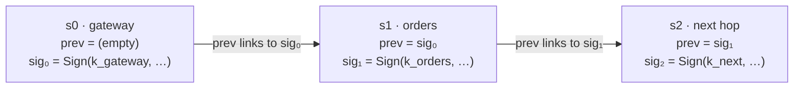
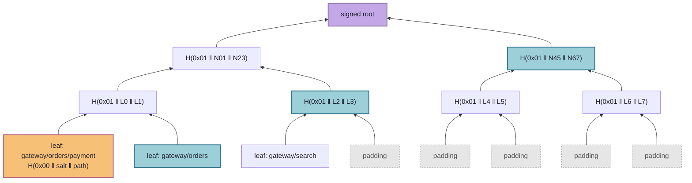

# Paztport

**A passport for requests.** The "zt" stands for zero trust.

Most security asks one question at the door: *who are you?* Paztport asks a
second question: ***how did you get here?***

That second question matters once an attacker has taken over one part of a
system. A request from that part carries its valid credentials, so a service that
asks only *who are you?* (the payment service, the customer database, the admin
panel) does what it's told.

This repository holds Paztport, a protocol for path attestation, written as a
[spec](poc-sdks/spec/README.md) (version 3). SDKs in Java and Go carry it over
HTTP, and one in TypeScript carries it over MCP, the protocol AI agents use to
call tools. Three demos run it: a small
[mesh of Spring Boot services](poc-demos/java-mesh/README.md), an
[Envoy Gateway](poc-demos/envoy-gateway/README.md) edge on a local Kubernetes
cluster, and an [AI agent](poc-demos/agents-mcp/README.md) calling a mock GitHub
MCP server. It is a proof of concept: nothing is published to a package registry,
and nothing has been audited. Claude, an AI model, wrote all of its code and
documentation ([How it was built](#how-it-was-built)).

## Quick start

`./run java-mesh` builds the Java SDK and the mesh demo, then runs every
scenario. It needs Maven on Java 25 or newer, and Docker, its daemon running,
with Compose. A green run ends `26 passed, 0 failed`, and the mesh stays up.
`./run test` runs the repository's checks and every suite, with no Docker and no
model. [Running it](#running-it) has the other demos and what each command needs.

## Contents

- [Quick start](#quick-start)
- [The idea in plain terms](#the-idea-in-plain-terms)
- [Concepts](#concepts)
- [What it does](#what-it-does)
- [How it works](#how-it-works)
  - [The problem](#the-problem)
  - [Two proofs](#two-proofs)
  - [Beyond routes](#beyond-routes)
  - [Design rules](#design-rules)
- [What the demos show](#what-the-demos-show)
- [What it doesn't do](#what-it-doesnt-do)
- [Running it](#running-it)
- [Repository layout](#repository-layout)
- [Where to go next](#where-to-go-next)
- [How it was built](#how-it-was-built)
- [Licence and third-party software](#licence-and-third-party-software)

## The idea in plain terms

Think about how a passport works. Every border you cross stamps it, and customs at
your destination looks at the stamps, not just at your face. Paztport gives every
request inside a system the same kind of passport:

- **Every step stamps it** with a signature nobody else can forge. Skip a step or
  fake one, and the stamps stop lining up.
- **The destination checks the whole itinerary**, not just the last hop. A payment
  request is accepted only if it arrived by a route on the approved list.
- **The approved list stays sealed.** Each service holds a single fingerprint of
  it, so it can check a route without any service holding the full map of how the
  system fits together. That includes a partner, and an attacker who gets inside.

When a request turns up with the wrong history, it's refused. That holds even when
its credentials are valid and its contents look perfectly normal. The refusal can
also produce a signed event that, where the evidence allows, names the machine that
sent the request; the caller is never told. What happens next is your choice:
Paztport defines the event and when it may be acted on, not the response. In the
demo, a responder acts on it by moving the machine into isolation and replacing it
with a clean copy, automatically, within seconds.

## Concepts

<!--
Note for the author: this section is yours to write, in your own words. A
first-time reader reaches it straight after the plain-terms idea. The opening
names the technique, path attestation, without defining it, and the sections
below use these terms: origin, stamp, chain, receiver, proof, root, keyring, the
live order of checks, the `audit` and `enforce` modes, responder and event,
influence, and session. Until this section exists, each term gets a
one-clause definition where it is first used, indexed below so you can find them
and fold them in. Defined once here, the terms let the rest of the README lean
on them. A protocol term is bold where it is defined; tool and demo jargon is
not.

Where each term is defined now: the heading, then the line as committed (text
written here moves every line below it down).
- stamp: used first in The idea in plain terms (57); defined in Proof
  of travel (190).
- chain, origin, receiver: Proof of travel (190, 191, 192).
- responder: used first in The idea in plain terms (70); defined in
  Proof of travel, after the bullets (242).
- event: used first in The idea in plain terms (67); defined in Proof
  of travel, after the bullets (242).
- session, policy: What it does (124); the session's `sess`
  field in the stamp table (213).
- `audit` and `enforce`: What it does (144, 145).
- influence: the stamp table's `infl` row (216); its classes in Influence
  (393).
- call window, run window: the stamp table's `ts` row (212).
- peer check, nonce cache: Proof of travel, last bullet (235, 237).
- root, policy key, proof: Proof of legitimacy (252, 253, 254).
- policy tool, proof bundles, keyring: Proof of legitimacy, the tree bullets
  (316, 329, 330).
- live order: Why you need both (350).
- operation, request tree: Operations (368, 380).
- attested: used first in What it does (125); defined in Sessions
  (436).
- unsafe, partner, egress: Sessions (438, 449, 451).
- circuit breaker (the demo responder's): What the demos show (500).
- `ext_proc` and pi (demo jargon): What the demos show (516, 530).
-->

## What it does

- It limits what a break-in is worth. A compromised component can do only what
  its legitimate position in the system allows: an attacker who takes over the
  search service gets the search service, not the payment system behind it.
  Paztport doesn't make the compromised machine trustworthy; it limits how far
  the compromise can travel. [Known limits](docs/limits.md) lists what it needs
  from a deployment and what it cannot do.
- It carries calls between organisations. The two sides first open a
  **session**, exchanging the signed fingerprints of their **policies**, each
  side's list of approved routes. In an attested session the sender's internal
  route stays inside. The Java and Go SDKs implement this over HTTP; in the Java
  mesh, a payment provider plays the second organisation ([Sessions](#sessions)).
- It covers an AI agent's tool calls. The
  [agents demo](poc-demos/agents-mcp/README.md) stamps each call an agent makes to
  an MCP server. A planted prompt injection asks the agent to copy private notes
  into a public pull request, and with Paztport on, the server refuses that write
  because untrusted text and private data both shaped it. The demo's data has no
  owners, so there [the owner-aware rule](#the-owner-aware-rule) reduces to
  untrusted content plus any private data; the Java mesh's
  [support-assistant storyline](poc-demos/java-mesh/README.md#the-support-assistant-storyline)
  exercises its owner clause. In the demo's one recorded
  [eval](poc-demos/agents-mcp/eval/README.md#recorded-results), 20 runs per
  setting on one local model against a mock server, 9 of 20 runs leaked the
  private notes with Paztport off and none with it on, and without the planted
  issue Paztport refused nothing.
  [Where this could go](docs/directions.md) says what is still open.
- It is checked end to end. The Java mesh's `demo.sh` makes 26 checks, among them
  forged stamps, replays, altered bodies, expired requests, routes the policy does
  not list, **`audit`** mode (which records the verdict and lets a failing request
  through, where **`enforce`** refuses it), and the responder's quarantine with
  its limit on how often it acts; a green run ends `26 passed, 0 failed`
  ([the scenarios](poc-demos/java-mesh/README.md#running-it)).
- Its cost is measured, on one host. Checking a request takes a few Ed25519
  verifications and SHA-256 hashes. In the
  [Java mesh](poc-demos/java-mesh/README.md#measurements), `enforce` adds about
  1.9 ms at the median with one hop enforcing, most of it stock-JDK Ed25519, and
  that section ends with its caveats. The
  [Envoy Gateway](poc-demos/envoy-gateway/README.md#measurements) processor adds
  0.35 ms at the median at 1000 requests a second.

The code is Apache-2.0. Every cryptographic primitive the SDKs use comes from each
language's standard library (the JDK, Node's `node:crypto`, Go's `crypto`
packages); the Java keygen tool also uses Bouncy Castle, to write X.509
certificates.

---

## How it works

### The problem

Service C can verify that service B called it: mTLS and SPIFFE identities make that
*last hop* trustworthy, and say nothing about the hops before it. So an attacker who
compromises B, or tricks it, inherits every privilege B has downstream. A B tricked
into using its privileges for someone else is what Norm Hardy called a **confused
deputy** ("The Confused Deputy (or why capabilities might have been invented)", ACM
SIGOPS Operating Systems Review 22(4), 1988). Either way, the malicious request
looks identical to a legitimate one: same headers, same body shape, same
authenticated caller.

An illicit route leaves a fingerprint in the request's **history** even when the
request itself is clean. Paztport turns that history into a credential, and makes
it unforgeable without a hop's own key.

### Two proofs

A request is accepted only if it proves **two** things: that it really travelled
the route it claims (*proof of travel*), and that the route is one the system
allows (*proof of legitimacy*). Either proof alone leaves a hole. Together, a
request can neither claim a route it did not travel nor travel a route the policy
does not list.

#### Proof of travel: the stamp chain

Each hop appends a **stamp** to the request's **chain**, the list of stamps the
request carries, starting from its **origin**, the chain's first signer (over HTTP,
the chain travels in the `X-Path-Chain` header). A stamp names its **receiver**,
the service the hop hands the request to, which verifies the chain it is handed.
A stamp is signed by the hop's own Ed25519 key, and it signs over the previous
stamp's signature:



| Field | Meaning |
|---|---|
| `v` | Version, always `3`. |
| `svc` | Service name. The route is rebuilt from these and the `rcv` fields. |
| `inst` | The signer's instance, as the signer reports it (in the Java mesh, its container's hostname), so whoever acts on a failed check can act on one replica, not a whole service. |
| `rid` | Request ID, minted by the origin and carried unchanged. |
| `ts` | When this stamp was signed. The last stamp must be within the **call window** (5 s by default) of the receiver's clock, and the origin's within the **run window** (30 min by default, for an agent run that reuses one origin; inside one mesh, where a request is a single call rather than a run, the origin may be held to the call window too). |
| `sess` | The id of the session the chain was stamped in, or empty for a chain with no session, as inside one mesh. |
| `rcv` | The receiver this stamp was signed for: the next stamp's `svc`, or the chain's receiver. Over HTTP it may also name an operation, `service#operation`. |
| `bind` | The binding of what *this hop sent*. Over HTTP, `SHA-256(METHOD \n PATH \n BODY)` (`PATH` with its query). |
| `infl` | The commitment to the request's **influence**, the record of what content the context held when the call was decided; empty for no influence. |
| `prev` | The previous stamp's `sig`; empty at the origin. |
| `sig` | Ed25519 signature over the canonical bytes `3\|svc\|inst\|rid\|ts\|sess\|rcv\|bind\|infl\|prev`. |

Why it's built this way:

- Chaining through `prev = sig` makes the chain tamper-evident. Remove, reorder, or
  insert a stamp and some `prev` stops matching, or some signature stops verifying.
- Ed25519 rather than an HMAC means verifiers need only *public* keys. No shared
  secret is ever distributed, and a compromised verifier can't forge other
  services' stamps.
- The receiver binding, `rcv`, makes each stamp good only for the hop it was handed
  to: the next service, or the chain's receiver. A chain forwarded unchanged to any
  other service fails `BINDING_MISMATCH` before its route is looked at. Over HTTP
  `rcv` can also name the operation the call invokes there
  ([Operations](#operations)).
- The request binding ties the chain to the actual payload. The receiver recomputes
  `bind` from the request it got and compares it to the **last** stamp. A chain
  copied from a real request and spliced onto a malicious body no longer matches.
- Receiver binding, request binding and the **peer check** (with mTLS, the last
  signer must be the sender the transport authenticated) stop anyone but the signer
  using a stamp; a **nonce cache** refuses the signer's second sending on the
  replica that saw the first, and forgets a key after the nonce TTL (15 s by
  default, and never under twice the call window).

For each request that fails verification, in `audit` mode as well as `enforce`, a
service may send a signed **event** to its **responder**, a service that may act
on it, for example by isolating the instance it names
([events](poc-sdks/spec/wire.md#events)). A verdict can name the sender it holds
responsible, in the service's own logs and in the event, and who that can be
depends on whether the transport authenticated the sender
([Using it soundly](docs/limits.md#using-it-soundly)).

#### Proof of legitimacy: the salted Merkle tree

The allowed routes are hashed into a Merkle tree. A service pins only the
**root**, one 32-byte hash that stands for the entire policy, signed by the
**policy key**, the policy owner's signing key, which stays offline. A request
carries a **proof** of its route (over HTTP, the `X-Path-Proof` header): the
sibling hashes from its route's leaf up to the root.



*Illustrative depth-3 tree, whose routes name services alone; a route can also name
the operation each hop asks for ([Operations](#operations)). The proof for the
orange leaf is the three blue siblings; the verifier recomputes upward and compares
against the pinned root.*

How the tree is built, and why:

- **Leaf** = `SHA-256(0x00 ‖ salt ‖ "gateway/orders/payment")`.
  **Node** = `SHA-256(0x01 ‖ left ‖ right)`. The `0x00` / `0x01` domain-separation
  prefixes are mandatory. Without them, a 64-byte internal node could be passed off
  as a leaf: the classic Merkle second-preimage attack.
- Every leaf has a secret 128-bit salt. A route space is small enough to enumerate,
  so an unsalted `gateway/orders/payment` could be confirmed by hashing guesses;
  confirming a salted one means brute-forcing its salt, roughly `2¹²⁸` work, and
  sibling hashes and the root reveal nothing an observer can test guesses against.
  The leaf hash takes the salt as an argument, so there is no leaf function without
  one; the policy tool, which builds and signs a policy, draws a random 16-byte salt
  for each leaf, and a proof on the wire must carry a 16-byte `leafSalt`.
- Proofs are padded to a fixed depth (8 levels and 256 leaf slots by default, set
  by `PAZTPORT_PROOF_DEPTH` in the Java policy tool). Each route goes in a random
  slot, and unused slots are filled with random 32-byte values that look like any
  other hash. Proof length and position therefore leak nothing about how many
  routes exist or where in the policy one sits.
- The root is signed by the policy key over its `rootId`, the root and a validity
  window, `notAfter`. A widened policy can't be swapped in without that key, and a
  verifier stops relying on the root once its window has passed. The `rootId` is a
  random label for each build (`v` + 12 random hex chars), not derived from the
  policy, so two builds of one policy share neither a root nor an id. The window is
  7 days by default. Renewing signs the same tree again under the same `rootId` with
  a new `notAfter`, so proof bundles, the files that hold each service's proofs,
  stay valid. The policy key also signs the **keyring**, which names every
  service's key, the same way, with its own window.

#### Why you need both

- **Stamps alone** prove the travel but not its legitimacy. The verifier would
  need the full list of allowed routes, which reveals the map and has to be
  distributed everywhere. Without a policy check, any well-signed chain from a valid
  origin would pass.
- **Merkle proofs alone** prove that *some* route is allowed, not that *this
  request* took it. An attacker could claim a perfectly valid route and attach a
  proof for it.

The binding between the two is one rule: **the verifier rebuilds the route from the
authenticated fields in the stamps, never from any claimed field:** the origin's
`svc`, then the receiver each stamp names in `rcv`. It checks *that* route against
the root, and checks that the last `rcv` names itself. You can't claim a
route you didn't travel, and you can't travel a route that isn't in the tree.

A receiver makes these checks, with freshness, replay and the peer check among
them, in one fixed sequence, the **live order**, and the first that fails is the
result. The order is part of the protocol, so every implementation refuses the
same chain with the same code
([the live order](poc-sdks/spec/verification.md#the-live-order)).

The exact format is in the [protocol spec](poc-sdks/spec/README.md), and
[poc-sdks](poc-sdks/README.md#on-the-wire) has a summary.

### Beyond routes

The stamps and the tree prove which services a request passed through, and that its
route is allowed. Five more ideas carry the rest of the protocol: which handler each
hop was asked to run, what content shaped a request, which public writes that
content may make, whether an answer can be believed, and how far one side trusts
another's calls. Each ends in a link to the spec section that states it in full.

#### Operations

Over HTTP a service may name its **operations**, the handlers a request can run, so
that a policy can allow a route through one handler and not through another. The
service lists them in an operation table, by method, path template and, optionally,
a query condition, and the signed root covers each table, so tables are pinned with
the policy. A caller that holds the table names the operation in its stamp's `rcv`
as `service#operation`, so the route records what was asked for: the Java mesh
allows `gateway/orders#createOrder/payment#pay`. A receiver must not take its
operation from the request: it works out from its own routing which handler will
run, and a chain that names another fails `BINDING_MISMATCH`. The
[Spring starter](poc-sdks/java/README.md#operations) does this from Spring's
handler mappings; the [Go SDK](poc-sdks/go/README.md#what-the-embedder-does)
reads the tables and names operations, and leaves confirming them to the code
that embeds it. A caller calls each operation at most once per **request tree**,
the calls made under one origin's request ID; an operation that acts on one item
of many can declare a key, the path segment or query parameter that names the
item, and is then called once per item. Over MCP there are no operations, since a
tool call's receiver already names one tool
([operations](poc-sdks/spec/wire.md#operations),
[nonce keys](poc-sdks/spec/verification.md#freshness-and-replay)).

#### Influence

Influence travels with each call (`X-Path-Influence` over HTTP), and the call's last
stamp commits to it in `infl`, so a hop can't drop an entry without breaking the
stamp. Its entries record content such as a ticket's text, a customer's order or a
tool's result, and each has a class: `third-party` for content from outside the
trust boundary, which may carry instructions; `private` for data that must not reach
a public destination unless it belongs to the destination's owner; `public` for
what is already public; and `local-untrusted` for content nothing vouches for, such
as a response that was not attested. An entry may also name an owner, an opaque id
of whose data it is, which the service that served the data takes from its own
records, never from the content
([influence](poc-sdks/spec/sessions-and-influence.md#influence)).

#### The owner-aware rule

A write to a public destination is refused when its influence holds both untrusted
content (`third-party` or `local-untrusted`) and `private` data that is not the
destination owner's, an unknown owner on either side counting as someone else's. So
untrusted content can still steer a customer's own data to that customer, but never
someone else's data, or data whose owner nobody knows. The service applying the rule
takes the destination's owner from its own records, never from the request
([the owner-aware rule](poc-sdks/spec/sessions-and-influence.md#the-owner-aware-rule)).

#### Response attestation

An answer carries a stamp of its own: one more stamp on the request's chain, signed
for the caller over the status, the body and the labels of what the service
answered, each label a class and, where the service has one, an owner from its own
records (over HTTP, the `X-Path-Response` header). A service attests only an answer
to a request whose chain passed the live order there, so no origin attests, nor a
hop where Paztport is off, and neither a refusal nor a request that failed in
`audit` mode is attested. A service that confirms its operation a second time, as
the handler is about to run, attests only an answer whose handler it confirmed. The
caller adds the labels to its influence only when the whole response verifies, and
counts any other response as one `local-untrusted` entry, never dropped. An MCP
server attests a tool's result the same way, only for a call that verified
([who attests](poc-sdks/spec/verification.md#http-requests-and-responses),
[content labels](poc-sdks/spec/sessions-and-influence.md#content-labels)).

#### Sessions

Inside one organisation's mesh every service pins one policy in advance; across a
trust boundary the two sides open a session first: an MCP client with a server
before its first call, or one organisation with another over HTTP. Each sends its
signed root, policy key, keyring and a fresh nonce; the side that receives the
calls signs its reply; and every stamp in the session carries the session id in
`sess`, so a chain made for one session fails in any other. The receiving side
opens an **attested** session only when the sender's policy key is one it pinned
in advance, the sender's root and keyring verify under that key, and both sides'
roots and keyrings are current. Otherwise the session is **unsafe**: graded trust,
not a refusal, in which the receiving side verifies nothing, refuses what it lists
as disabled (`UNSAFE_SESSION`) and serves the rest
([status](poc-sdks/spec/sessions-and-influence.md#status),
[unsafe sessions](poc-sdks/spec/sessions-and-influence.md#unsafe-sessions)).

Over MCP, in an attested session the server attests the result of each call that
verified ([Response attestation](#response-attestation)). The client counts a
result that does not verify, and every result in an unsafe session, as
`local-untrusted`.

Between organisations, the receiving organisation, the **partner**, must not see
the sender's internal chain. In an attested session the sender's last internal
service, its **egress**, verifies the request's chain and sends one stamp of its
own in its place, so the internal route stays inside. That stamp commits to the
request's influence blinded to one entry for each class and owner, which is all
the partner needs to apply the owner-aware rule. In an unsafe session the egress
signs no stamp and sends no influence. Either way, a partner does not attest its
replies (see [Limits of the concept](docs/limits.md#limits-of-the-concept)), so
the egress counts each one `local-untrusted`. The Java and Go SDKs implement
this; the TypeScript SDK does not
([between organisations](poc-sdks/spec/sessions-and-influence.md#between-organisations)).

### Design rules

- Signatures and hashes are relied on for their standard properties: stamps are
  Ed25519 signatures, whose security rests on discrete log on Curve25519, and
  integrity (binding, replay, the tree) rests on SHA-256's preimage and collision
  resistance. Against a quantum attacker, Grover gives only a quadratic speedup
  against preimage search, while Shor breaks Ed25519 outright, which is why the
  post-quantum plan ([Where this could go](docs/directions.md)) keeps the Merkle
  tree and swaps only the signatures.
- Fail closed. Any parse error, missing header, unknown key, or expired stamp is a
  rejection; stripping the header must never become an escape hatch.
- One byte form, read strictly. Every Paztport object travels as its canonical JSON
  bytes (RFC 8785), or their base64url, and each SDK reads it from those bytes with
  its own strict reader, never through the transport's JSON parser. So every
  implementation accepts and refuses the same bytes, and one signed object has one
  form ([JSON](poc-sdks/spec/wire.md#json)).
- Only entry points start chains. A verifier accepts a chain only if its first
  stamp names a service it allows as an origin (`BAD_ORIGIN` otherwise) and
  verifies under that service's key, and a deployment gives those keys only to its
  entry points. So a compromised internal service can't start a chain that
  verifies, or forge an entry point's stamp.
- Never trust a claimed field. The route is rebuilt from the stamps' signed
  fields, never from a claimed one; a receiver's operation must come from its own
  routing, and a destination's owner from the deciding service's own records,
  never from the request.
- Log identities and verdicts, never secrets. Service IDs, request IDs and reason
  codes appear in logs; private keys, salts and proof bundles never do.

## What the demos show

The [Java mesh](poc-demos/java-mesh/README.md) runs Spring Boot services on mutual
TLS under Docker Compose, with a responder and a payment provider that stands in
for a second organisation. In its headline case, `search`, a
service legitimately on the network, adds its own stamp to a real chain and sends
it on to `payment`. The request is valid in every other respect, and it is refused
`PATH_NOT_ALLOWED` because of where it came from: the policy's only route through
`search` is `gateway → search`. The demo's responder acts on the signed events
`payment` sends it. After three refusals from one container within a minute, it
moves that container to an isolated network, where it keeps running for
inspection, and starts a clean copy in its place. Its circuit breaker allows at
most two quarantines of one service in ten minutes by default; past that, the
responder stops acting and logs `ESCALATE` for a person to take over, since a
legitimate route missing from the policy would make every replica of a service
look guilty. A support-assistant storyline runs customers' tickets through a
scripted stand-in for a hijacked model, with no model in it. An honest ticket is
refunded and emailed; one asking for Alice's data to go to Mallory is refused at
the mailer and at the payment provider by
[the owner-aware rule](#the-owner-aware-rule), though every hop was on an allowed
route ([the scenarios](poc-demos/java-mesh/README.md#running-it),
[the responder](poc-demos/java-mesh/README.md#response-quarantine-not-deletion),
[the storyline](poc-demos/java-mesh/README.md#the-support-assistant-storyline)).

The [Envoy Gateway proof of concept](poc-demos/envoy-gateway/README.md) puts
Paztport at a Kubernetes edge, on a local kind cluster. A Go processor, which
Envoy calls over gRPC for each request through its external processing filter
(`ext_proc`), and which its own Helm chart installs, stamps each request entering
the gateway as the origin service `edge`; the Java mesh's `orders` and `payment`
verify it. Its checks show that a chain a client sends is replaced at the edge,
not believed, that a request sent around the edge is refused, and that a stamp
taken from the processor is refused from any connection but Envoy's. Its
measurement run also tested failure. A processor container killed under load cost
under a second of refused requests and let none through unstamped. With every
replica gone, Envoy Gateway's default routing let requests through unstamped as
the processor came back, which backends in `enforce` refuse; routing Envoy to the
processor's Service let none through
([what the measurements showed](poc-demos/envoy-gateway/README.md#what-the-measurements-showed),
which also covers adding routes and rotating the edge's key).

The [agents demo](poc-demos/agents-mcp/README.md) carries chains over MCP, with
the TypeScript SDK. An extension to pi, a coding agent, stamps each tool call the
agent makes to a mock GitHub MCP server, verifies each response, and tracks the
influence of what the agent has read. Its default scenario holds the planted issue
that [What it does](#what-it-does) describes. The model runs locally through
Ollama unless you point the demo at a hosted one, and a local web page shows one
run at a time. An eval (`npm run eval`) runs the agent many times in each of five
settings: Paztport on and off with the planted issue, on and off without it, and
off with a published defence wording added to the system prompt. It scores each
run from the mock server's record of the tool calls, never from what the model
says it did ([the eval](poc-demos/agents-mcp/eval/README.md)).

## What it doesn't do

The most important limits, each linked to its section of
[docs/limits.md](docs/limits.md), which also lists what a deployment must supply
for Paztport to hold:

- A compromised service on an allowed route can still misuse that route: Paztport
  checks a request's position, not whether the services on its route behave
  ([limits of the concept](docs/limits.md#limits-of-the-concept)).
- Whoever holds a service's keys is that service. Proving that a workload is a
  legitimate deployment is left to the workload-identity layer
  ([limits of the concept](docs/limits.md#limits-of-the-concept)).
- The peer check needs mutual TLS ended in the service's own process. The SDKs do
  not support a sidecar mesh, where TLS ends in a proxy beside the service
  ([using it soundly](docs/limits.md#using-it-soundly)).
- Without a peer, anyone holding a captured request can send it again to the same
  receiver within the call window, and only the replica that saw it first refuses
  it ([using it soundly](docs/limits.md#using-it-soundly)).
- A keyring or root shown in a session handshake can be replayed until it expires,
  7 days by default, so a leaked key or a removed route stays usable that long
  unless a new policy key is pinned
  ([using it soundly](docs/limits.md#using-it-soundly)).
- The owner-aware rule judges only the influence a request carries, and passes what
  it cannot see: where a chain did not pass the live order (Paztport off on a hop,
  a chain that failed in `audit` mode, a call in an unsafe partner session), that
  influence may be incomplete or empty. The rule also counts content's presence
  rather than its effect, and judges whose data shaped a write, not who may
  receive it ([using it soundly](docs/limits.md#using-it-soundly),
  [limits of the concept](docs/limits.md#limits-of-the-concept)).
- The proof hides the policy, not a request's own route: whoever verifies a chain
  learns the route it took
  ([limits of the concept](docs/limits.md#limits-of-the-concept)).
- The SDKs' nonce caches are in memory, one per replica, so a request sent twice
  can be served twice by another replica or after a restart; the receiving
  application must handle duplicate delivery
  ([using it soundly](docs/limits.md#using-it-soundly)).
- Queues, caches and scheduled jobs are out of scope: they break the model of one
  linear chain ([using it soundly](docs/limits.md#using-it-soundly)).
- This proof of concept keeps keys and certificates in files or Kubernetes
  Secrets, with no workload attestation, and its responder controls Docker through
  the host's socket
  ([limits of this proof of concept](docs/limits.md#limits-of-this-proof-of-concept)).

## Running it

```bash
./run test        # the name, link and Java import checks, the TypeScript type checks, gofmt, go vet and staticcheck, every suite, a check of the built jars and of the processor's third-party list; no Docker and no model
./run java-mesh   # build the Java SDK and the mesh demo, then run every scenario; the mesh stays up
./run envoy-gateway  # the edge processor on Envoy Gateway in a local kind cluster, and its checks; the cluster stays up
./run envoy-gateway measure  # the measurement suites, on a cluster of their own; needs python3
./run agents-mcp  # install the TypeScript SDK and the agents demo, set up demo keys, start the demo page
./run bench       # time the primitives a verifying hop pays for (JMH, a few minutes); not part of test
```

What each command needs, at the lowest versions `./run` accepts:

- `./run test`: Maven, running on Java 25 or newer (as `mvn -v` reports it);
  Node 22.19 or newer, with npm; Go 1.27 or newer; staticcheck 2026.2.2 or newer;
  and unzip, for the jar check.
- `./run java-mesh`: Maven on Java 25 or newer, and Docker, its daemon running,
  with Compose.
- `./run envoy-gateway`: Maven on Java 25 or newer; Docker, its daemon running;
  Go 1.27 or newer; kind 0.33, kubectl 1.36 and Helm 4.3, or newer. With
  `measure`, also python3 3.9 or newer.
- `./run agents-mcp`: Node 22.19 or newer, with npm; and Ollama, running, with a
  model pulled (for example `ollama pull qwen3:4b`).
- `./run bench`: Maven on Java 25 or newer.

`./run` runs on macOS and Linux; on Windows use WSL. With no argument it prints
its usage. A missing prerequisite stops it with one line naming what is missing,
before anything is built; Ollama is the exception, which `./run agents-mcp` only
reports as reachable or not. Each folder still builds on its own; its README has
the commands.

## Repository layout

```
paztport/
├── LICENSE, NOTICE           Apache-2.0, copyright
├── LICENSING.md              what each jar and image carries, and why
├── THIRD-PARTY.txt           runtime dependencies and their licences (generated)
├── licenses/                 licence texts the bundling jars carry, and the licence plugin's shared settings
├── docs/                     limits.md, the known limits in full; directions.md, where this could go
├── run                       front door: java-mesh, envoy-gateway, agents-mcp, test, bench
├── poc-sdks/
│   ├── spec/                 the protocol spec, and vectors/: v3.json, which every SDK replays (Java and Go all of it but the MCP profile); http-v3.json, Java's and Go's; events.json, all three's; json.json, TypeScript's but its http bindings, Java's and Go's but the MCP profile's sections
│   ├── scripts/              name check, link check, import check, jar check, tests for ./run, THIRD-PARTY.txt regeneration
│   ├── java/                 core, http, spring (paztport-core, paztport-http, paztport-spring), tools/keygen, tools/policy-tool, tools/bench
│   ├── typescript/           core, mcp (@paztport/core, @paztport/mcp), policy-tool
│   └── go/                   one module: the protocol's packages, and paztporthttp with wire and boundary
└── poc-demos/
    ├── java-mesh/            services/ (gateway, orders, payment, search, tickets, assistant, mailer), psp, responder; Compose, demo.sh, measure.sh, load.js, policy/ (paths.yaml, ops-*.json), psp-policy/
    ├── envoy-gateway/        the edge at Envoy Gateway: the Go ext_proc processor, its Helm chart, a kind cluster and its checks
    └── agents-mcp/           agent/MCP demo
        ├── mock-github-mcp/  mock GitHub MCP server (+ docs server), stdio, demo agent target
        ├── pi-extension/     pi extension: stamps MCP calls, verifies responses, tracks influence
        ├── policies/         the client and server route policies that setup-demo signs
        ├── scripts/          setup-demo: throwaway demo keys and policies
        ├── eval/             runs the agent many times per setting, scores from the outcome log, verify
        ├── demo-ui/          local web page: one run at a time, evidence per call, results folders
        └── scenarios/        scenario folders: repositories, planted text, scoring data
```

## Where to go next

- [poc-sdks](poc-sdks/README.md): the SDKs and a summary of the on-the-wire format.
  - [poc-sdks/java](poc-sdks/java/README.md) and
    [poc-sdks/typescript](poc-sdks/typescript/README.md): one section per package.
  - [poc-sdks/go](poc-sdks/go/README.md): the Go module's packages, and what the code
    that embeds it does.
  - [poc-sdks/spec](poc-sdks/spec/README.md): the protocol spec and the shared conformance
    vectors.
- [poc-demos](poc-demos/README.md): the demos.
  - [poc-demos/java-mesh](poc-demos/java-mesh/README.md): the mesh walkthrough, threat
    model, scenarios, responder, measurements and configuration.
  - [poc-demos/envoy-gateway](poc-demos/envoy-gateway/README.md): the edge processor at
    an Envoy Gateway, its chart, and the checks on a local kind cluster.
  - [poc-demos/agents-mcp](poc-demos/agents-mcp/README.md): the agent and MCP demo.
- [docs/limits.md](docs/limits.md): the known limits in full: what a deployment
  must supply, what any design of this kind cannot do, and what this proof of
  concept leaves out.
- [docs/directions.md](docs/directions.md): where Paztport could go beyond this
  proof of concept, among them post-quantum signatures, production agent runtimes,
  async boundaries and scale.

## How it was built

Claude, an AI model made by Anthropic, wrote all of the code and documentation in
this repository. The author set the goals, made the design decisions and reviewed
the results.

The work went in stages: a design for each piece, then a plan that split it into
tasks, then the tasks one at a time. Each task was reviewed on its own, and each
branch was reviewed as a whole before it was merged. The designs, plans and
reviews are kept outside this repository and are not linked from it, so that the
repository stands on its own and leans on no document a reader cannot see.

What you can check for yourself:

- The [conformance vectors](poc-sdks/spec/README.md#conformance) in
  `poc-sdks/spec/vectors/` are recorded answers that the Java, TypeScript and Go
  SDKs replay, each the parts for the transports it speaks, so the three
  implementations are held to one set of answers.
- `./run test` runs the repository's own checks, the TypeScript type checks,
  gofmt, go vet and staticcheck, every suite of the three SDKs and the demos, and a
  check of what the built jars carry. It needs no Docker and no model. The
  repository's own checks are three scripts. `check-names.sh` fails on a tracked
  file that names where the designs, plans and reviews are kept: the private
  workspace folder, a path into a `docs/specs` or `docs/plans` folder (where its
  designs and plans sit), or the workflow plugin that ran the tasks, whose notes
  folder bears its name. None of those is in the repository. `check-links.mjs`
  fails on a Markdown link to a missing file or heading, and `check-imports.mjs`
  on a Java import the file does not need.
- The Java mesh and Envoy Gateway READMEs say how their numbers were measured, on
  which host and with which versions, and the Envoy Gateway README names the run
  they come from. The measurement scripts are in the repository; their raw results
  stay on the machine that ran them and are not committed.

## Licence and third-party software

Copyright 2026 The Paztport Authors. Licensed under Apache-2.0 (see
[LICENSE](LICENSE) and [NOTICE](NOTICE)). Its patent grant (section 3) licenses
each contributor's patent claims that their contribution infringes, to everyone who
uses the code, commercially included, and ends for anyone who sues over them. The
source tree contains no third-party code, but some built jars (the shaded tool jars
and the demo's Spring Boot jars) bundle libraries; [LICENSING.md](LICENSING.md)
says which. [THIRD-PARTY.txt](THIRD-PARTY.txt) lists the
runtime dependencies and the licence each is used under, and
[LICENSING.md](LICENSING.md) says what each jar and image carries, and how to
regenerate the list.
