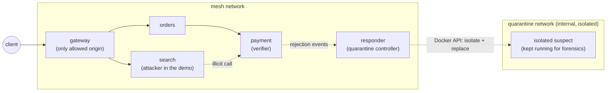
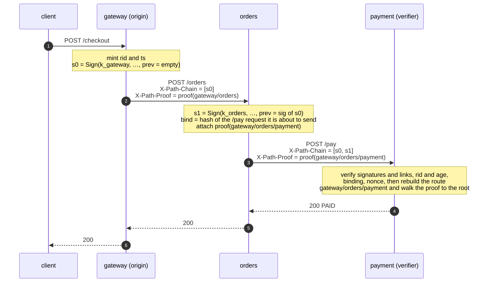
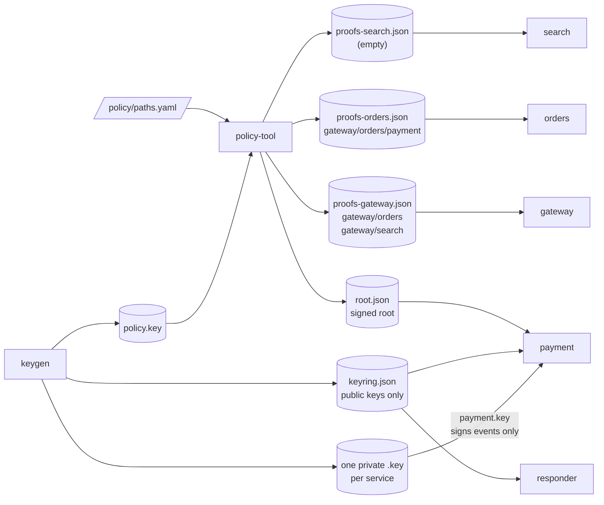
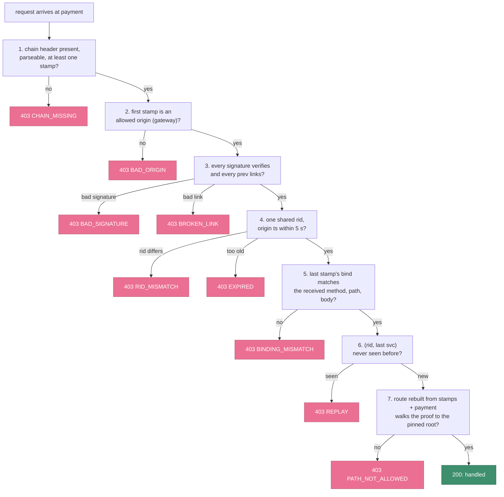
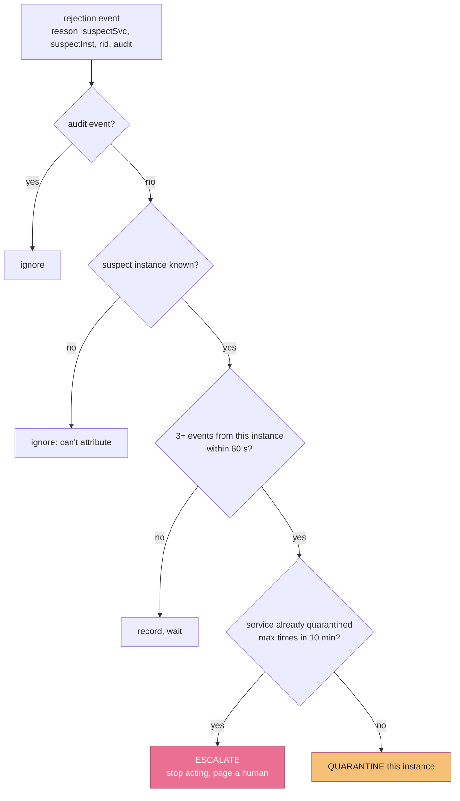
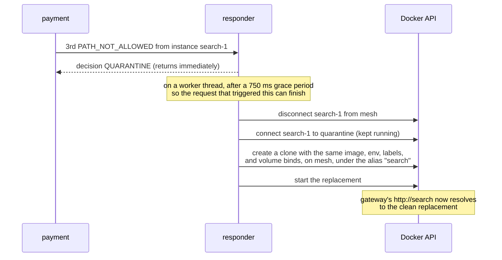

# Java mesh demo

A small mesh of Spring Boot services that uses the Java SDK
([poc-sdks/java](../../poc-sdks/java/README.md)), with a responder that
quarantines offending containers. The idea and the concepts are in the
[root README](../../README.md).

Contents: [The system at a glance](#the-system-at-a-glance) · [A request, end to end](#a-request-end-to-end) · [Least knowledge](#least-knowledge-who-holds-what) · [The verification pipeline](#the-verification-pipeline) · [Threat model](#threat-model) · [Response](#response-quarantine-not-deletion) · [Modes and rollout](#modes-and-rollout) · [What building it taught us](#what-building-it-taught-us) · [Measurements](#measurements) · [Running it](#running-it) · [Configuration](#configuration)

## The system at a glance

The demo is a small mesh of four services. `payment` is the sensitive endpoint
and the verifier. `search` is reachable on the network and can call `payment`, but
its only legitimate route is `gateway → search`, so in the demo it plays the
attacker.



Allowed routes live in [`policy/paths.yaml`](policy/paths.yaml):

```yaml
paths:
  - [gateway, orders, payment]
  - [gateway, orders]
  - [gateway, search]
```

| Component | Role |
|---|---|
| `services/*` | Four tiny Spring Boot services. The business logic is deliberately trivial. |
| `responder` | Counts rejections and quarantines and replaces offending containers through the Docker API. |

The services use `paztport-spring`, and Compose runs the SDK's `keygen` and
`policy-tool` as one-shot jobs; [poc-sdks/java](../../poc-sdks/java/README.md)
describes them.

## A request, end to end



Application code never touches any of this. The Spring outbound interceptor
stamps every `RestClient` call through core's `OutboundStamper`. It takes the
target service from the request URI host (Compose service names double as
hostnames), takes the inbound chain from a request-scoped context, and attaches
the proof for `(chain so far) + target` if this hop holds one. The inbound filter caches the body, records the received chain
for later appends, and runs verification on verifying services.

## Least knowledge: who holds what

Each route's proof goes to exactly one place: that route's **second-to-last hop**,
because that hop attaches it when calling the last hop. Least knowledge is enforced
by *distribution*, not just by policy.



| Component | Holds | Never holds |
|---|---|---|
| gateway / orders | Own private key; own proof bundle | Other services' keys, the tree, any salts but its own proofs' |
| payment (verifier) | Public keyring, signed root, nonce cache; its own key, used only to sign events to the responder | Any other private key, the tree, salts, proofs |
| search | Own private key; an **empty** bundle | Any proof for a route ending at `payment`, because none exists |
| responder | Public keyring, to check that events are signed by `payment`; the Docker socket | Any private key, the root, the tree, salts, proofs |
| policy-tool | The full tree and every salt | Nothing is mounted *from* it into services |

In Compose this is enforced with per-file bind mounts. Each container sees only the
specific files its role needs, never a shared volume of all keys.

The heart of the demo is `search`'s empty bundle. `search` can reach `payment` on
the network and can sign stamps with its own key. It was never given a proof for a
route to `payment`, and it can't make one: the route `gateway/search/payment` isn't
a leaf, and collision resistance means no sibling set will walk a non-leaf up to
the root.

## The verification pipeline

`payment` runs a fixed sequence of checks and fails closed at the first one that
doesn't hold:



Notes on the ordering:

- The order is deliberate. Cheap structural checks run first. The signatures run
  before anything trusts a field. Freshness and binding run before the replay cache
  is touched, which is why a body altered on a replayed request reports
  `BINDING_MISMATCH` and an aged one reports `EXPIRED`.
- A missing or unparseable **proof** gives `PATH_NOT_ALLOWED`, not `CHAIN_MISSING`:
  without a valid proof you can't show membership. `CHAIN_MISSING` is reserved for
  the chain.
- **Step 8**, which checks that the last stamp's `svc` matches the real transport
  caller, needs mTLS and isn't implemented yet. It's a documented gap (see
  [Known limits](../../README.md#5-known-limits)).
- Every rejection returns a 403 with the reason code and publishes an event for
  the responder.
- Only `PATH_NOT_ALLOWED` names a suspect (the last stamp's service and instance).
  By step 7 the signatures verified, the links hold, and the chain is fresh, bound
  to this exact request and unseen, so the last hop's service really sent it. The
  **service** is proven by its key. The **instance** is what that service's own key
  holder wrote in its stamp, so it is a claim, not a proof; the responder acts only
  when the named container really runs the named service (see [Response](#response-quarantine-not-deletion)). Before step 7
  the names are unsigned or unverified, or the genuine last stamp belongs to
  someone else's request (a replayed or altered capture), so the suspect is left
  empty rather than blaming an innocent signer.

## Threat model

**The attacker** fully controls one service (`search` in the demo). That includes
its private key, its network position, and every header it receives. The network
lets it call `payment` directly; there is no NetworkPolicy to hide behind. It
does **not** have other services' private keys or the policy key. Its goal is to
get `payment` to act on a request.

| Attack | What stops it | Demo scenario |
|---|---|---|
| Call `payment` with no attestation | Fail closed: missing chain is invalid, never "legacy traffic" | 2: `CHAIN_MISSING` |
| Forge a stamp claiming to be `gateway` | Verified against gateway's public key, which the attacker can't sign for | 3: `BAD_SIGNATURE` |
| Forward a real chain it legitimately received | Route rebuilt from stamps (`gateway/search/payment`) is not a leaf | 4: `PATH_NOT_ALLOWED` |
| Replay a captured valid request | `(rid, last svc)` nonce already spent | 5: `REPLAY` |
| Keep a valid chain, swap the body | Last stamp's `bind` no longer matches | 6: `BINDING_MISMATCH` |
| Hold a chain and use it later | Origin `ts` older than the freshness window | 7: `EXPIRED` |
| Keep attacking | Instance isolated and replaced after a threshold | 9: quarantine |

**Not defended by design:** a compromised hop that sits on a *valid* route can
still misuse that route. If `orders` were compromised, it could alter what it sends
to `payment`. It would sign the altered request itself, so the misuse is
attributable to it, but it isn't prevented. Attestation constrains **position**,
not **trustworthiness**. The practical result is that lateral movement becomes
*positional*: a compromised node can do only what its legitimate place in the
graph allows.

## Response: quarantine, not deletion

The chain shows exactly where a route stopped being valid, so the response can
target **one instance** rather than a whole service. Docker has no ReplicaSet, so
the `responder` plays that role through the Docker socket.

The decision logic is a small pure function, unit-tested without Docker:



The action is then carried out asynchronously:



Why each piece is there:

- **Quarantine, don't delete.** The suspect moves to an isolated network and keeps
  running, so you keep a live specimen for forensics while a clean replacement
  serves traffic.
- **Attribute to the instance.** Stamps carry the container hostname, so the
  responder isolates one replica, not every pod in the service. The service is
  proven by its key, but the instance is reported by that service's own key
  holder, so the responder acts only when the named container really runs the
  named service (its Compose service label). Replacements carry the same label.
  Counts are kept per service and instance, so one service's events can't build up
  a count against another's container. Only `PATH_NOT_ALLOWED` events carry a
  suspect; every other rejection leaves it empty and takes the "ignore: can't
  attribute" branch.
- **Require a threshold** (3 in 60 s). One bad event doesn't trigger action, and
  audit-mode events never do.
- **Circuit breaker** (by default at most 2 quarantines per service per 10 min).
  If a deploy adds a legitimate route before the root is updated, every pod on it
  looks guilty. Past the limit the responder stops acting and logs `ESCALATE`.
  Repeated quarantines of one service are also the **reinfection signal**: if the
  replacement is flagged again, the image or an input is the problem, not the pod.
- **Only signed events count.** Anyone on the mesh can reach the responder, so
  `payment` signs each event with its own key (`PAZTPORT_EVENT_KEY_PATH`) inside an
  envelope, and the responder checks it against `keyring.json` with core's
  `EventVerifier`. It refuses, with a
  403 and no decision, any event that is unsigned, from a signer other than the
  allowed ones (`payment` by default), badly signed, more than 30 s from the
  responder's clock, or whose `eventId` it has already seen.

## Modes and rollout

Each verifying service runs in one of three modes (`PAZTPORT_MODE`):

| Mode | Verifies | Rejects | Use |
|---|---|---|---|
| `off` | no | no | Latency baseline |
| `audit` | yes, logs events marked `audit=true` | no | Measure the false-positive rate on real traffic |
| `enforce` | yes | yes, with a 403 | Protection |

`audit` is the on-ramp for an existing system. You run it against real traffic,
measure how often retries, health checks, and batch jobs trip it, fix the policy,
then flip individual endpoints to `enforce`. The responder ignores audit events, so
nothing gets quarantined while you're learning.

## What building it taught us

Some of the most useful results came from running the system live, not from the
unit tests. Each of these was root-caused before it was fixed:

- **The quarantine severed the request that triggered it.** The first responder
  acted synchronously inside the event POST. But the suspect was *part of the
  call chain* that produced the event (`demo → search → payment → responder`), so
  pulling it off the network mid-request meant `payment`'s 403 could never be
  delivered back. The triggering call hung. Fix: decide synchronously, act
  asynchronously after a short grace period. The general lesson: **a response
  system must never sit inside the path of the thing it's responding to.**
- **Fresh salts mean fresh root bytes, so every holder reloads together.** The
  `rootId` stays stable for a given policy, but each `policy-tool` run draws new
  salts and the root bytes change. If you restart only the verifier, the callers
  still hold proofs for the old tree and every legitimate request fails. Policy
  rollout has to be atomic across every holder. That's a miniature of the "policy
  drift" problem real deployments will face.
- **Control-plane endpoints must bypass the data-plane check.** The inbound filter
  first verified *every* path, including the admin and debug endpoints, and
  rejected them for lacking a chain. Attestation applies to the attested data path,
  not to the control plane.
- **Infrastructure the responder needs has to be created by the responder.**
  Compose doesn't create a network that no service joins, and a container created
  with networking disabled can't then join a network. Both were caught only by
  watching real Docker API errors.

## Measurements

Measured on a single host (Apple Silicon, Docker Desktop, JDK 21) with k6 driving
the legitimate path (10 virtual users for 20 s, via
[measure.sh](measure.sh)). `payment` is toggled between `off` and
`enforce` with everything else identical, so the difference is the cost of
verification.

| | p50 | p99 |
|---|---|---|
| `payment` in `off` | 3.57 ms | 6.43 ms |
| `payment` in `enforce` | 3.86 ms | 5.39 ms |

| Operation | Cost |
|---|---|
| Merkle proof verify (depth 8) | **1.6 µs** |
| SHA-256 (one stamp) | 0.09 µs |
| Ed25519 sign / verify (stock JDK) | ~222 / ~226 µs |
| Headers at chain depth 2 | 814 B chain + 615 B proof = **1.4 KB** |

What the numbers say:

- **Verification adds about 0.3 ms**, which is within run-to-run noise on a
  ~3.6 ms request. The HTTP hops dominate.
- **The proof of legitimacy is effectively free.** All the cost is in the
  signature chain, one Ed25519 verify per hop.
- **Stock JDK Ed25519 is the slow part.** It runs about 5–10× slower than
  optimized native implementations, which do tens of microseconds. A hot-path
  deployment would swap the signature implementation; the Merkle machinery
  wouldn't change.
- **Headers grow about 407 B per hop.** The proof is a fixed 615 B whatever the
  route length.

Caveats:

- **Single host, loopback networking.** These numbers show feasibility. They
  aren't a production SLA.
- **`off` vs `enforce` isolates verification, not stamping.** Callers stamp in
  both modes, and each stamp costs one Ed25519 sign (about 0.22 ms per outbound
  call). Only `payment` verifies in this topology, so a design that verifies at
  every hop multiplies the verify cost by the number of verifying hops.
- **Micro-benchmarks are JIT-warmed.** Cold starts pay JIT and class-loading costs
  that aren't reflected here.
- **The false-positive rate isn't measured.** Retries, health checks, and batch
  jobs need real traffic in `audit` mode, and this local POC doesn't generate any.

## Running it

**Prerequisites:** JDK 21 or newer, Maven, Docker with Compose.

`./run java-mesh` from the repository root does the build and runs `demo.sh`.
By hand, from this folder:

```bash
(cd ../../poc-sdks/java && mvn -q install -DskipTests)  # the SDK jars and the tool jars
mvn -q package -DskipTests              # build every module
docker compose build keygen policy-tool # package the freshly built jars
docker compose run --rm keygen          # per-service keys + keyring
docker compose run --rm policy-tool     # signed root + per-service proof bundles
export PAZTPORT_ADMIN_TOKEN=$(openssl rand -hex 16)   # token for /admin/mode
docker compose up -d --build            # the mesh + responder
./demo.sh                               # run every scenario, print pass/fail
docker compose up -d --force-recreate payment   # back to your token (see below)
./measure.sh                            # optional: off vs enforce latency + header sizes
```

`measure.sh` switches `payment` between `off` and `enforce` through `/admin/mode`,
so it needs the token `payment` was started with, and it stops with an error if a
switch is refused. `demo.sh` generates its own token on every run and leaves
`payment` running with it, so after `demo.sh` recreate `payment` from a shell that
has your `PAZTPORT_ADMIN_TOKEN` (or re-run `docker compose up -d`) before `measure.sh`.

`docker compose run` reuses an existing image and never rebuilds it. If you
change and rebuild the Java code, run `docker compose build keygen policy-tool`
again before generating keys or policy. Otherwise the old jars run, and you get
output in the old format, for example private keys that aren't owner-only.
`up --build` rebuilds the mesh services itself. Private key files are written
owner-read/write only (`0600`).

`demo.sh` is idempotent. It cleans up any replacement containers, restores the
original policy, rebuilds the root, resets the mode to `enforce`, and runs:

| # | Scenario | Expected |
|---|---|---|
| 1 | client → gateway → orders → payment | 200 |
| 2 | search calls payment with no headers | 403 `CHAIN_MISSING` |
| 3 | search forges a stamp claiming to be gateway | 403 `BAD_SIGNATURE` |
| 4 | search forwards a real `gateway→search` chain to payment | 403 `PATH_NOT_ALLOWED` |
| 5 | a captured valid request is replayed | 403 `REPLAY` |
| 6 | valid chain, body altered after the last stamp | 403 `BINDING_MISMATCH` |
| 7 | a chain older than the max age | 403 `EXPIRED` |
| 8 | scenarios 2–4 in `audit` mode | 200, events logged, no quarantine |
| 9 | three illicit calls from search in `enforce` | search isolated; a fresh search serves `gateway→search` |
| 9b | another round past the per-service limit | responder logs `ESCALATE` |
| 10 | add `[gateway, search, payment]`, rebuild root | scenario 4 now returns 200: policy drives behaviour |

The attacks run inside the mesh, from `search`'s `/attack/*` endpoints (enabled
only when `ATTACK_MODE=true`). Only the gateway port is exposed to the host.

## Configuration

| Variable | Default | Used by |
|---|---|---|
| `PAZTPORT_MODE` | `enforce` | verifiers (`off`, `audit`, `enforce`) |
| `PAZTPORT_MAX_AGE_MS` | `5000` | verifiers |
| `PAZTPORT_ORIGINS` | `gateway` | verifiers |
| `PAZTPORT_PROOF_DEPTH` | `8` | policy-tool |
| `ATTACK_MODE` | `false` | search |
| `PAZTPORT_ADMIN_TOKEN` | empty, so `/admin/mode` refuses every request | `payment` (the demo generates one per run) |
| `RESPONDER_URL` | empty, so events are only logged | verifiers (the demo sets it for scenario 9) |
| `PAZTPORT_EVENT_KEY_PATH` | `/config/keys/payment.key` in Compose; required when `RESPONDER_URL` is set | `payment` |
| `PAZTPORT_KEYRING_PATH` | `/config/keys/keyring.json` | `payment` (verifies stamps), responder (verifies event signatures) |
| `RESPONDER_ALLOWED_SIGNERS` | `payment` | responder |
| `QUARANTINE_THRESHOLD` | `3` | responder |
| `QUARANTINE_MAX_PER_SVC` | `2` | responder (the demo uses `1` so `ESCALATE` comes sooner) |
